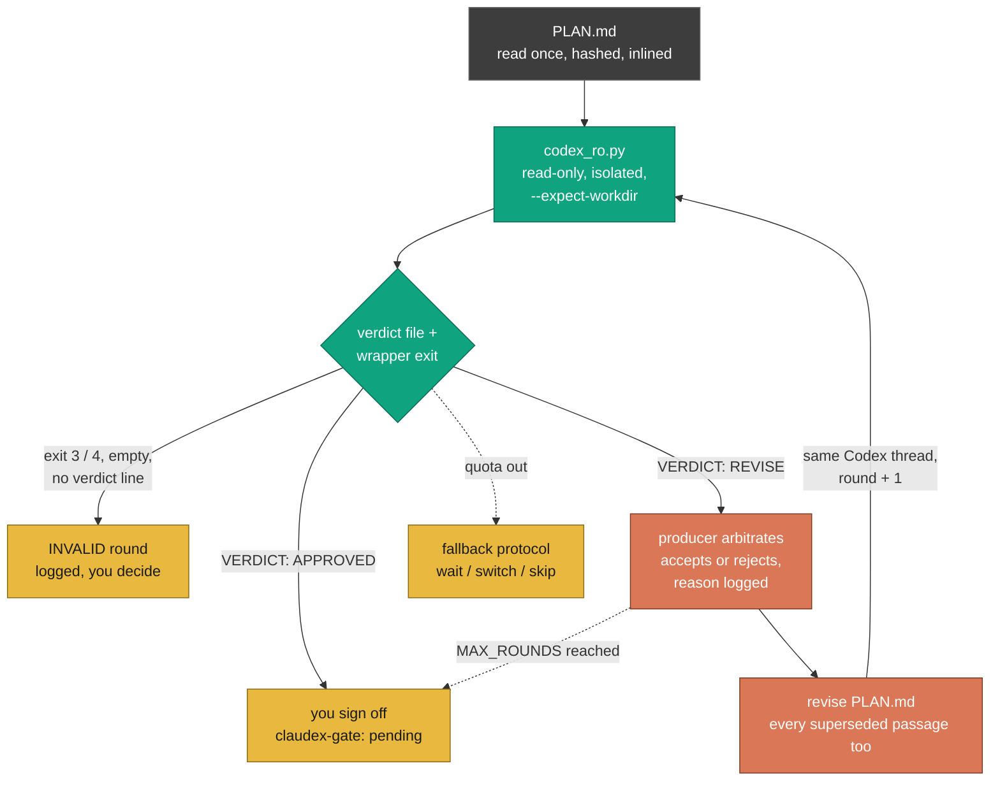
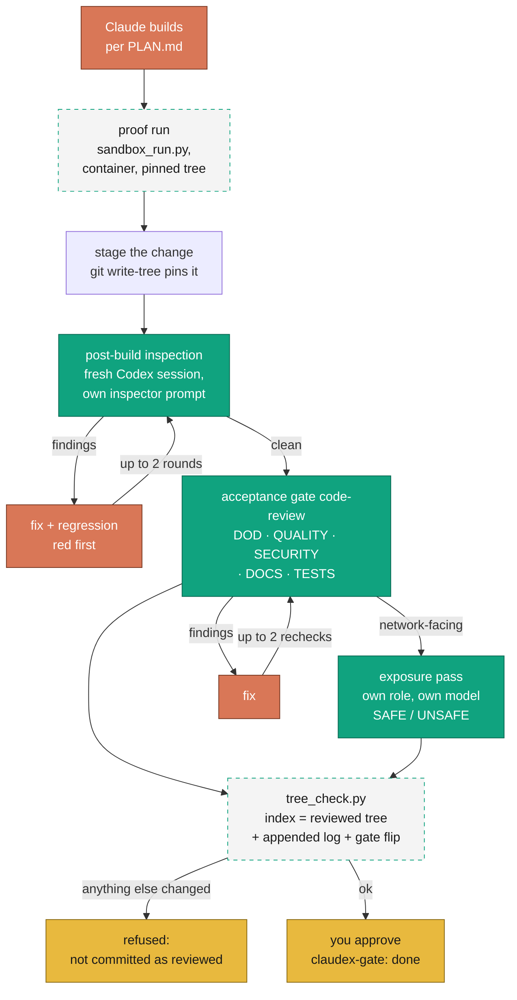
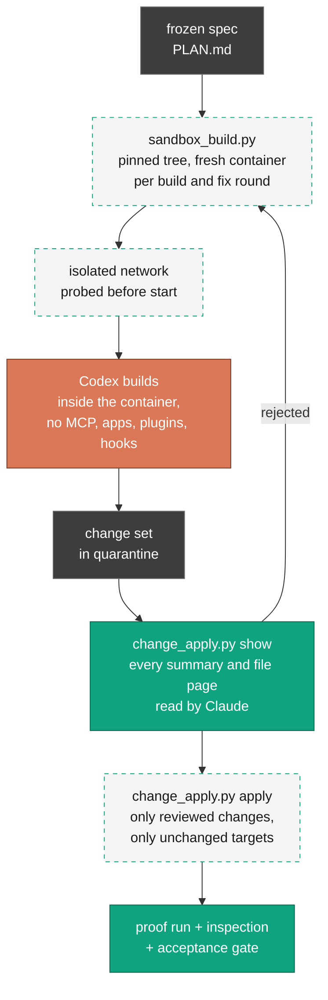
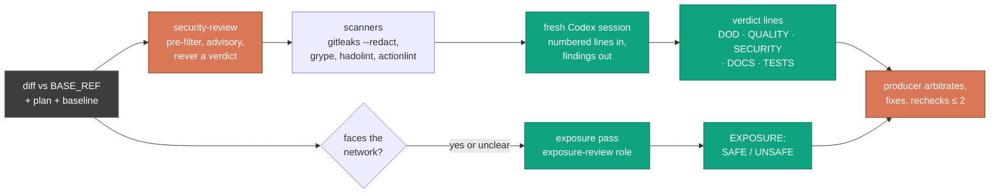
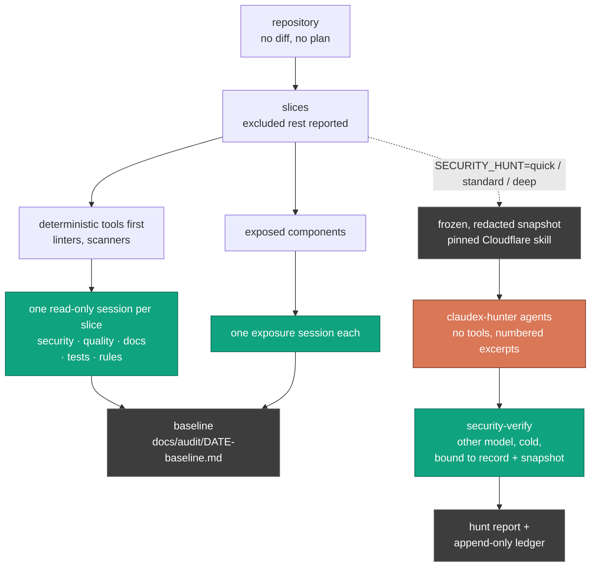
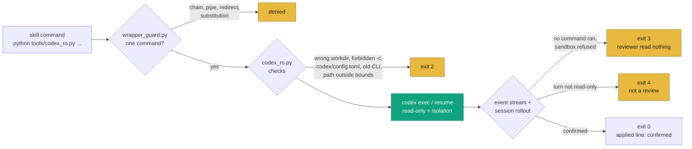
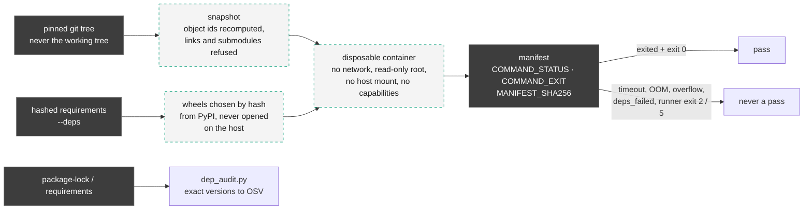
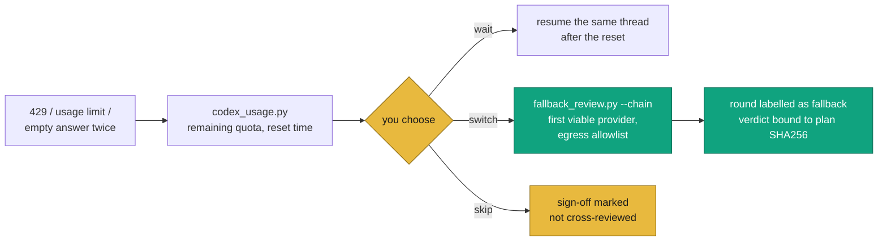

<div align="center">


### Zwei KI-Modelle härten deinen Plan, bevor eine Zeile Code existiert — dann tauschen sie die Rollen und bauen ihn.

[](https://github.com/ujconsulting/claudex-loop/stargazers)
[](./LICENSE)
[](https://docs.anthropic.com/en/docs/claude-code)
[](https://github.com/openai/codex)

*Der Plan, der fertig klingt, ist es meistens nicht. Im ersten echten Lauf von claudex-loop enthielt ein gründlich recherchierter, im Interview festgezurrter Plan immer noch **ein nicht baubares Subsystem und sechs Entwürfe, die Daten zerstört hätten** — ein rivalisierendes Modell fand alle, bevor Code existierte.*

[English](README.md) | [Deutsch](README_DE.md)

<sub>Hervorgegangen aus einem Fork von [chaseai-yt/claudex-loop](https://github.com/chaseai-yt/claudex-loop) von Chase AI — seit 22.09.2026 ein eigenständiges Projekt. Siehe [Danksagungen](#danksagungen).</sub>

</div>

> Beide Fassungen werden zusammen gepflegt; `tests/test_readme_sync.py` schlägt fehl,
> sobald die Kommandos in einer der beiden abweichen.

> **Neu hier?** Der [Einstieg](docs/einstieg.md) erklärt ohne Vorwissen, worum es geht, warum man
> das heute braucht, welche Werkzeuge wofür laufen und wie man es in neue und bestehende Projekte
> einbindet. English: [Getting started](docs/getting-started.md).
>
> **Fremde Werkzeuge prüfen** (Plugins, Skills, MCP-Server, Pakete), bevor sie installiert werden,
> übernimmt das Schwesterprojekt [ujc-security-checker](https://github.com/ujconsulting/ujc-security-checker).
> Wie sich beide unterscheiden und ergänzen:
> [Einstieg, Abschnitt 13](docs/einstieg.md#13-das-schwesterprojekt-ujc-security-checker).

---

## Was dieses Projekt gegenüber Upstream ergänzt

Am Fork-Punkt (24.08.2026, Upstream-Commit `f8c111d`) bestand das Projekt aus **drei Skill-Dateien und einer README**: `claudex-loop`, `codex-review` und `codex-build`. Kein Skript, kein Hook, kein Test. Alles, was die Skills versprachen — *read-only*, *das andere Modell benotet* — war eine Anweisung an das Modell, und nichts prüfte, ob sie befolgt wurde. Dieses Projekt hat aus den Versprechen Kontrollen gemacht, die Kontrollen dann auditiert und die meisten zunächst umgehbar gefunden. Was es heute gibt:

| Bereich | Upstream am Fork-Punkt | Hier | Seit |
|---|---|---|---|
| **Read-only-Review** | `-s read-only` im Skill-Text, rohes `codex exec` | Ein Wrapper ([`codex_ro.py`](./scripts/codex_ro.py)) für jeden Codex-Aufruf: Sandbox bei `exec` *und* `resume` festgenagelt, `-c`-Überschreibungen, die die Sandbox berühren, abgelehnt, Schreibziele eingegrenzt, Nutzerkonfiguration/MCP/Apps/Plugins/Web abgeschaltet. Exit **3**, wenn der Prüfer keine einzige Datei lesen konnte, Exit **4**, wenn Codex' eigenes Sitzungsprotokoll zeigt, dass der Zug nicht read-only lief, `--expect-workdir`, damit ein Review nicht in einem Verzeichnis läuft, das niemand gewählt hat | 2.2.0 → 2.7.0 |
| **Sicherheit der Allowlist** | — | `PreToolUse`-Wächter: ein freigegebener Wrapper-Aufruf bleibt **ein** Kommando — keine Verkettung, kein Pipe, keine Umleitung, keine Substitution, die auf seiner Freigabe mitfährt | 2.2.0 |
| **Wer was tut** | Das Modell steckt im Skill-Namen | Rollen in `.claudex.yaml`, aufgelöst von [`claudex_roles.py`](./scripts/claudex_roles.py); zwei Gates verweigern mit Exit-Code ungleich null: niemand benotet die eigene Arbeit, kein Prüfer mit offener Sandbox | 2026-08 |
| **Codex-Kontingent leer** | Die Schleife läuft in eine Sackgasse | Kontingent-Prüfung, Fallback-Prüferkette (LM Studio, Ollama, OpenRouter, …), nie automatisch, Egress-Allowlist sperrt im Zweifel (ohne Eintrag kein Versand) | 2.2.0 |
| **Inspektion nach dem Bau** | Eine Kreuzinspektion, wenn Claude baut | Eigener Inspektor-Prompt (Abnahmekriterien, jede geänderte Datei vollständig, Tests, die nur den Code bestätigen), bis zu **2 Runden**, beurteilt auf dem **gestagten Baum** (`git write-tree`); [`tree_check.py`](./scripts/tree_check.py) lässt nichts in den Commit außer dem Log und der Gate-Marke | 2026-10 |
| **Abnahme-Gate** | — | [`code-review`](#jenseits-des-plans): `DOD` · `QUALITY` · `SECURITY` · `DOCS` · `TESTS`, bis zu **2 Nachprüfungen**, ein eigener **Exposure-Pass** für alles, was zum Netz zeigt, Claudes `security-review` als beratender Vorfilter. Jeder Plan trägt `claudex-gate: pending; due-after: <step>`, und ein Commit-Hook erinnert, solange es offen ist | 2026-09 |
| **Codebase ohne Review-Geschichte** | — | [`audit`](#jenseits-des-plans): in Scheiben geschnittenes Erst-Review, deterministische Werkzeuge zuerst, nummerierte Zeilen, Exposure-Sitzung je exponierter Komponente, eine **Baseline**, damit spätere Reviews nur die Differenz beurteilen | 2026-08 |
| **Sicherheitsjagd** | — | `audit` Schritt 3c nach Cloudflares `security-audit`: gepinnter, byte-genau geprüfter Skill-Schnappschuss, eingefrorene geschwärzte Eingabe, Jäger **ohne Werkzeuge**, jeder Befund kalt vom anderen Modell verifiziert, nur anhängendes Ledger | 2026-10 |
| **Doku-Schulden** | — | `docs-backfill`: Claude schreibt Docstrings, eine frische read-only-Sitzung benotet, ob sie *wahr* sind | 2026-09 |
| **Ein Repo einrichten** | — | `setup` + [`wrapper_drift.py`](./scripts/wrapper_drift.py): Prüferrolle, Prüfkatalog, Tabu-Scope, Trust-Eintrag, Wrapper-Kopien auf demselben Stand | 2026-08 |
| **Claude als Prüfer** | Ein Teil-Agent erbt jedes Sitzungswerkzeug | Plugin-Agenten `claudex-reader` (`Read, Grep, Glob`) und `claudex-hunter` (keine Werkzeuge) — gemessen, von Tests gehalten | 2026-10 |
| **Code des geprüften Repos ausführen** | Auf dem Host | In einem Wegwerf-Container ohne Netz auf dem **gepinnten Git-Baum**, kein Host-Fallback ([`sandbox_run.py`](./scripts/sandbox_run.py), B1); Abhängigkeiten werden **ohne Paketwerkzeug auf dem Host** installiert, Audits gegen OSV (B1.5) | 2026-10/11 |
| **Codex als Bauender** | `--yolo` mit jedem MCP-Server, Plugin und jeder App der Nutzerkonfiguration | Zuerst jedes externe Werkzeug namentlich abgeschaltet ([`build_isolation.py`](./scripts/build_isolation.py)); jetzt ein Container-Bau mit Quarantäne und seitenweiser Durchsicht, bevor etwas angewendet wird (**B2: gebaut, Abschluss-Gate noch offen**) | 2026-10/11 |
| **Beweis** | — | ~1.600 Tests, CI auf Linux · macOS · Windows, shellcheck, actionlint, gitleaks, bandit, pip-audit (not prescribed for repositories under review); jede geschlossene Lücke hat einen Test, der zuerst rot war | laufend |
| **Doku & Offenlegung** | Englische README | Deutsche Fassung, von Tests im Gleichlauf gehalten, das eigene Audit des Projekts als Belege, `SECURITY.md` mit privater Schwachstellenmeldung | 2026-09 |

Wie jedes davon abläuft, zeigt [So funktionieren die einzelnen Teile](#so-funktionieren-die-einzelnen-teile).

## Warum

KI-gestütztes Programmieren scheitert an zwei Stellen: an der Lücke zwischen **dir und Claude** (sind wir uns einig, was gebaut wird?) und an der Lücke zwischen **Claude und seiner eigenen Ausgabe** (ist der Plan tatsächlich korrekt — und woran würdest du das merken?). Dem Modell, das den Plan geschrieben hat, kann man die Benotung nicht anvertrauen. Das ist eine Echokammer.

Claudex-loop schließt beide Lücken: Claude zurrt die Absicht *mit dir* fest, dann greift **OpenAI Codex** — ein rivalisierendes Modell eines anderen Anbieters — den festgezurrten Plan Runde für Runde an, bis es nichts mehr findet.

```mermaid
flowchart LR
    A["🔍 RECON<br>codebase recon or<br>greenfield research"] --> L["📋 Assumptions Ledger<br>you confirm in one batch"]
    L --> B["🎯 INTERROGATE<br>load-bearing questions<br>one at a time"]
    B --> P["PLAN.md locked"]
    P --> C["⚔️ PLAN REVIEW<br>the adversary attacks it<br>in a read-only sandbox"]
    C -- REVISE --> R["the producer arbitrates<br>and revises"]
    R -- same session --> C
    C -- APPROVED --> S["✍️ You sign off"]
    C -. MAX_ROUNDS:<br>you break the tie .-> S
    S -. optional .-> D["🔨 BUILD<br>one model writes<br>in sandbox"]
    D --> T["⚙️ PROOF RUN<br>in sandbox"]
    T --> I["🔬 CROSS-INSPECT<br>the other model<br>grades the diff"]
    I --> G["✅ You approve<br>the final diff"]
    I -. default on,<br>a skip is logged .-> V["🧪 ACCEPTANCE GATE<br>dod · quality · security<br>+ docs · tests"]
    V -. facing the network:<br>then it is required .-> X["🛡️ EXPOSURE PASS<br>own model, own effort<br>SAFE / UNSAFE"]
    V --> G
    X --> G
    classDef producer fill:#d97757,stroke:#7a3a24,color:#fff
    classDef adversary fill:#10a37f,stroke:#0a6b54,color:#fff
    classDef human fill:#e8b93e,stroke:#8a6a14,color:#1a1a1a
    classDef artifact fill:#3d3d3d,stroke:#6b6b6b,color:#fff
    classDef sandbox fill:#f4f4f4,stroke:#10a37f,color:#1a1a1a,stroke-dasharray: 5 5
    class A,B,R,D producer
    class C,I,V,X adversary
    class L,S,G human
    class P artifact
    class D,T sandbox
```



*(Die Grafik bleibt bewusst englisch — sie ist mit der englischen Fassung identisch, damit beim Ändern nicht eine von beiden zurückbleibt.)*

**Du kommst an genau vier Stellen ins Spiel:** Annahmen-Ledger bestätigen, Interview beantworten, den konvergierten Plan abzeichnen und — falls gebaut wird — den finalen Diff freigeben. Jeder prüfende Schritt läuft read-only und fasst keine Datei an.

**Orange ist, wer produziert, Grün ist, wer benotet — nicht Claude und Codex.** Die Farben benennen *Rollen*, denn hier ist der Akteur dahinter Konfiguration (siehe [Der Akteur ist Konfiguration, kein Name](#der-akteur-ist-konfiguration-kein-name)). In der Delegations-Aufstellung tauschen die Kästen das Modell, ohne dass sich die Grafik ändert.

**Gepunktete Kanten sind bedingt.** Das Bauen ist optional. Das Abnahme-Gate auf dem fertigen Diff ist **standardmäßig an** — überspringen geht (Opt-out, oder das Codex-Kontingent ist leer und kein Fallback gewählt), aber nur mit protokolliertem Grund; zeigt die Änderung zum Netz, sind es und sein Exposure-Pass Pflicht, und `EXPOSURE: UNSAFE` blockiert den Commit. Ein Plan, der an `MAX_ROUNDS` endet, kommt auf denselben Weg, sobald du den Gleichstand auflöst. Jeder abgeschlossene Plan trägt die Markierung `claudex-gate: pending; due-after: <last plan step>`, damit auch ein Bau in einer *späteren* Sitzung weiß, dass das Gate noch aussteht — und nach welchem Schritt es fällig ist. `pending` vor diesem Schritt ist der Normalzustand, keine Schuld: das Gate vergleicht das fertige Ergebnis mit dem Plan, mitten im Bau kann es nur `INCOMPLETE` antworten. Durchgezogene Kanten passieren immer. `audit`, `docs-backfill` und `setup` fehlen absichtlich: sie sind überhaupt keine Schritte dieser Schleife — siehe [Jenseits des Plans](#jenseits-des-plans).

## Die vier Phasen

| | Was passiert | Was den Unterschied macht |
|---|---|---|
| **🔍 0 — RECON** | Claude erkundet, *bevor* es dich irgendetwas fragt — Codebase und lebende Doku, oder auf der grünen Wiese Stand der Technik, Stacks und bekannte Fallstricke (die Rechercheteife ist ein Tor, das **du** kontrollierst, bis hin zu einem Multi-Agenten-Deep-Research-Workflow) | Beginnt mit einem **Annahmen-Ledger**: alles bereits Geklärte, in einer Antwort gebündelt bestätigt. Das Interview verschwendet keine Frage, die Code oder Recherche schon beantwortet haben |
| **🎯 1 — INTERROGATE** | Eine sichtbare **Entscheidungskarte** trennt offene Entscheidungen in tragende (einzeln gefragt) und kosmetische (gebündelt, Veto per Ausnahme) | Jede Frage muss ihre Existenz rechtfertigen: *warum sie zählt*, eine verbindliche *Empfehlung*, und *was kaputtgeht, wenn wir falsch raten*. Notausgang: „alle übrigen Empfehlungen übernehmen" |
| **⚔️ 2 — REVIEW** | Codex prüft `PLAN.md` in einer read-only-Sandbox → `VERDICT: APPROVED` oder `REVISE` mit konkreten Mängeln. Claude entscheidet (weist schlechte Kritik *mit protokollierter Begründung* zurück), überarbeitet — jede Stelle, die noch ein überholtes Verhalten beschreibt, die Abnahmekriterien eingeschlossen, wird geändert oder markiert, damit keine Fassung beides sagt — und setzt **dieselbe Codex-Session** fort | Der Prüfer erinnert sich an seine früheren Funde und greift seine eigenen akzeptierten Fixes an. Begrenzt durch `MAX_ROUNDS` — eine ausgewiesene Pattsituation schlägt ein vorgetäuschtes „approved" |
| **🔨 3 — BUILD** *(optional)* | Du wählst den Bauenden. **Codex baut** (`build`, beschreibbarer Container; Quarantäneprüfung vor Veröffentlichung) → Claude liest den gesamten Diff wie einen Contributor-PR und führt den Beweistest selbst aus — in einem Wegwerf-Container auf dem geprüften Baum (`scripts/sandbox_run.py`), nie auf dem Host. **Claude baut** → eine *frische* read-only-Codex-Session inspiziert den fertigen Diff gegen den Plan — standardmäßig an, Funde werden entschieden und protokolliert. Ein Fund, der ändert, *was* gebaut werden muss, ändert `PLAN.md` selbst und kommt an deinem Gate als Planänderung nach der Freigabe an. Der Inspektor bekommt einen eigenen Prompt (Abnahmekriterien, jede geänderte Datei vollständig, Tests, die nur den Code bestätigen) und beurteilt die **gestagte** Änderung: der Index wird mit `git write-tree` festgehalten, und vor dem Commit lässt `scripts/tree_check.py` genau die eigenen Änderungen des Reviews zu — das Log wächst nur, die `claudex-gate:`-Marke im Plan springt um — und sonst nichts, sodass ein Commit mit ungeprüftem Inhalt nicht als geprüft committet wird | Der finale Code wird immer vom rivalisierenden Modell benotet, egal welches ihn geschrieben hat. Die Inspektion zu überspringen verlangt einen ausdrücklichen, protokollierten Opt-out |

**Die Invariante über alle vier:** *wer die Sache gemacht hat, prüft die Sache nie.* Plan von Claude → angegriffen von Codex. Code von Codex → geprüft von Claude. Code von Claude → inspiziert von Codex. Niemand benotet die eigene Arbeit, auf keinem Pfad.

Zwei Artefakte pro Lauf: `PLAN.md` (das *Was* — samt Abschnitt `Verification`: die Änderung an der echten Ausgabe des Programms nachweisen, das ihre Eingaben erzeugt, und bei geändertem Verhalten alten und neuen Code über dieselben Eingaben laufen lassen) und `PLAN-REVIEW-LOG.md` (die vollständige Auseinandersetzung Runde für Runde — das *Warum*).

## Jenseits des Plans

Phase 3 endet mit `code-review`, dem Abnahme-Gate auf dem fertigen Diff — standardmäßig an, überspringbar nur mit protokolliertem Grund. **Es ist zugleich ein eigenständiger Skill, und die drei darunter sind es auch:** jeder läuft für sich, auf Artefakten, die die Schleife nie erzeugt — ein Diff, der ohne Plan entstand, eine Codebasis, die nie geprüft wurde, liegengebliebene Doku-Schulden, ein Repo, das noch nicht eingerichtet ist.

| Skill | Beurteilt | Verdikt |
|---|---|---|
| **`code-review`** | den fertigen Diff gegen den Plan, in bis zu fünf Dimensionen — dazu, für alles was zum Netz zeigt, einen separaten Exposure-Pass auf eigenem Modell | `DOD` · `QUALITY` · `SECURITY` · `DOCS` · `TESTS` · `EXPOSURE` |
| **`docs-backfill`** | stehende Doku-Schulden, losgelöst von jedem Diff | `DOCS: ACCURATE / INACCURATE` |
| **`audit`** | eine Codebase, die nie jemand geprüft hat — kein Diff, kein Plan, keine Baseline | `AUDIT: CLEAN / CONCERNS / CRITICAL` je Scheibe · `EXPOSURE: SAFE / UNSAFE` je exponierter Komponente |
| **`setup`** | nichts — es *richtet ein Repo ein*: Wrapper, Prüferrolle, Prüfkatalog, Tabu-Scope, Trust | ein echter read-only-Codex-Aufruf, der antworten muss |

`code-review` hat `docs` und `tests` bekommen, weil ein Gate, das nie fragt „ist das dokumentiert" und „würden die Tests fehlschlagen, wenn der Code falsch wäre", die zwei billigsten Defekte stehen lässt. Nimm sie dazu, sobald der Diff Verhalten ändert.

Steht `security` im Umfang, läuft zuerst Claude Codes eigenes `security-review` als **Vorfilter** (`SECURITY_PREFILTER=on`, seit 27.10.2026): billig, und es räumt das Offensichtliche ab, bevor Codex-Kontingent verbraucht wird. Es setzt nie das `SECURITY`-Verdikt und zählt nie als Bestanden — hat Claude die Änderung gebaut, schaut hier der Hersteller auf die eigene Arbeit —, und seine Befunde bekommt Codex nicht zu sehen; es liest die Änderung kalt.

**Claude-Gutachter laufen ohne die Werkzeuge der Sitzung** (seit 27.10.2026). Ein Teil-Agent ohne Werkzeugliste erbt alles, was die Sitzung hat — gemessen: er fand über ToolSearch die schreibfähigen claude.ai-Konnektoren (Notion, Gmail, Drive, …). Löst eine prüfende Rolle auf `claude` auf, läuft sie jetzt als Plugin-Agent `claudex-reader` (`tools: Read, Grep, Glob`; gemessen: genau diese, kein ToolSearch, kein MCP); die Analysten der kommenden Sicherheitsjagd laufen als `claudex-hunter` ganz ohne Werkzeuge. Die Hauptsitzung behält ihre Werkzeuge — der Vorfilter und ein Claude-Bau laufen dort, und das steht da, statt verschwiegen zu werden. Details: [`ROLES.md`](./ROLES.md).

`audit` existiert, weil `code-review` einen Diff und einen Plan braucht und ein geerbtes Repo beides nicht hat. Es schneidet das Repo in Scheiben, lässt **zuerst** die deterministischen Werkzeuge laufen, damit das Modell seine Aufmerksamkeit dort ausgibt, wo Linter nicht hinkommen, und erzeugt eine **Baseline** — danach beurteilt jedes spätere `code-review` nur noch die Differenz, statt dieselben Schulden erneut aufzuwerfen.

Mit `SECURITY_HUNT=quick|standard|deep` ergänzt `audit` eine **Jagd nach Angriffsklassen** nach der Methode von Cloudflares [`security-audit`](https://github.com/cloudflare/security-audit-skill) (seit 27.10.2026; Plan nach sieben Codex-Runden freigegeben). Der Skill wird aus einem byte-genau geprüften Schnappschuss eines gepinnten Commits gelesen, nie aus einer lebenden Installation. Die Jäger sind `claudex-hunter`-Agenten **ohne Werkzeuge**, die nur auf nummerierten Auszügen eines eingefrorenen, geschwärzten Schnappschusses des Repos arbeiten; Zielcode wird nie ausgeführt. Jeder Befund wird danach **kalt vom anderen Modell** geprüft (`security-verify`, Default Codex), gebunden an genau diesen Datensatz und diesen Schnappschuss, mit Belegen nur aus den Zeilen, die ihm geschickt wurden. Die Ergebnisse landen in eigenem Bericht und wörtlichem Ledger unter `docs/audit/`, nie im gemeinsamen Log. Was es nicht leistet: der read-only-Prüfer kann das Repo weiterhin selbst lesen, wie in jedem Codex-Review — eine echte Lesegrenze kommt erst mit dem Container-Plan.

`docs-backfill` schreibt, was die Gates als fehlend gemeldet haben. Claude schreibt, eine frische read-only-Session benotet: ein Generator, der Docstrings ausgibt und ausliefert, hat niemanden, der prüft ob sie *stimmen* — und ein selbstbewusst falscher Docstring ist schlimmer als ein fehlender.

`setup` fällt aus der Reihe: es beurteilt nichts, es *installiert*. Pro Repo verdrahtet es die Prüferrolle, den projektspezifischen Prüfkatalog, den Tabu-Scope (read-only heißt, Codex *schreibt* nicht — alles was es *liest*, geht trotzdem an OpenAI), den Trust-Eintrag und den read-only-Wrapper weiter unten.

### Der Akteur ist Konfiguration, kein Name

Upstream backt das Modell in den Skill-Namen (`codex-review` prüft, `codex-build` baut). Das liest sich gut, bis man die andere Aufstellung will — dann lügt der Name. Hier sind die Skills nach der **Tätigkeit** benannt, und wer sie ausführt, kommt aus `.claudex.yaml`:

```yaml
roles:
  plan: claude          # Delegation:  build: codex + code-review: claude
  plan-review: codex    # Dual draft:  plan: [claude, codex] + plan-review: cross
  build: claude
  code-review: codex
  exposure-review: codex   # second grader of build — gpt-6.1-sol/medium by default, see ROLES.md
  docs: claude
  docs-review: codex
  audit: codex
```

`scripts/claudex_roles.py` löst das auf und **verweigert mit einem Exit-Code ungleich null** — keine Warnung —, wenn ein Akteur seine eigene Arbeit benoten würde (`producer_never_reviews`) oder eine prüfende Rolle mit offener Sandbox liefe (`write_access`). Claude ist der Orchestrator, deshalb wird eine Prüferrolle auf `claude` abgelehnt, sofern sie nicht als frischer Subagent antritt. Vollständige Begründung in [`ROLES.md`](ROLES.md).

### Eine Lehre, die es zu stehlen lohnt

**Gib dem Prüfer nummerierte Zeilen.** Der erste echte `audit`-Lauf lieferte stichhaltige Funde an falschen Adressen — Zitate landeten auf Leerzeilen und unbeteiligten Anweisungen, weil der Code unnummeriert in den Prompt ging und das Modell *zählen* musste. Auf derselben 2.658-Zeilen-Scheibe gemessen: 5 von 23 Zitaten auf Leerzeilen ohne Nummerierung, 0 von 28 mit. Ein paar Prozent mehr Input-Tokens beseitigen die gesamte Fehlerklasse.

## So funktionieren die einzelnen Teile

Die Grafik unter [Warum](#warum) ist die ganze Schleife auf einer Seite. Im Folgenden jeder Teil für sich — was läuft, was geprüft wird und wo es aufhört. Dieselben Farben: Orange produziert, Grün benotet, Gelb bist du, Grau ist eine Datei, gestrichelt ist eine Sandbox oder ein Container.

### Planprüfung — der Gegenspieler greift den Plan an



Jede Runde steht in `PLAN-REVIEW-LOG.md`, bevor die nächste beginnt. Eine Runde zählt nur mit einer nicht leeren Antwort, deren letzte Zeile ein Verdikt ist; ein Exit 3 (der Prüfer hat nichts gelesen) oder Exit 4 (der Zug war nicht read-only) ist ungültig, was immer die Antwort sagt.

### Nach dem Bau — Inspektion, Abnahme-Gate, Commit

Diese Stufe hatte Upstream in dieser Form nicht. Wenn Claude baut, stehen drei unabhängige Prüfungen zwischen dem fertigen Diff und dem Commit:



- **Die Inspektion** fragt: *setzt der Diff den Plan korrekt um?* Ein Fund, der ändert, *was* gebaut werden muss, geht in `PLAN.md` und erreicht dich als Planänderung nach der Freigabe, nicht als stiller Fix.
- **Das Abnahme-Gate** fragt: *ist alles da, ist es sauber, ist es sicher, ist es dokumentiert, würden die Tests fehlschlagen, wenn der Code falsch wäre?* Jede Dimension hat ihre eigene Verdikt-Zeile.
- **`tree_check.py`** lässt „geprüft" genau die Bytes bedeuten, die committet werden: Alles, was sich nach dem Review geändert hat, außer dem Log und der Gate-Marke, verweigert den Commit.
- **`gate_reminder.py`** nennt bei `git commit` jede `PLAN.md`, deren Gate noch `pending` ist, samt dem Schritt, nach dem es fällig ist — einmal je Sitzung, nie blockierend.

### Codex baut — Container und Quarantäne (B2, Abschluss-Gate offen)



Nichts, was Codex schreibt, erreicht den Arbeitsbaum, bevor Claude es gelesen hat. Es gibt kein Fortsetzen der Sitzung und keinen Host-Fallback. Die Einzelheiten zu Netz und Zugangsdaten stehen unter [Sicherheit](#sicherheit). B2 ist gebaut und getestet, hat sein Abschluss-Gate aber noch nicht bestanden.

### Abnahme-Gate — eine Sitzung, fünf Dimensionen, ein Exposure-Durchlauf



Die Funde des Vorfilters werden Codex nie gezeigt — es liest die Änderung kalt. `EXPOSURE: UNSAFE` blockiert den Commit.

### Audit und Sicherheitsjagd — eine Codebasis ohne Review



Die Baseline liest jedes spätere `code-review` als bekannte Schuld, damit dieselben Funde nicht bei jeder Änderung erneut aufgeworfen werden.

### Ein Codex-Aufruf — was gelten muss, bevor eine Antwort zählt



Ein Timeout ergibt Exit 124, ein verweigerter Batch-Starter unter Windows Exit 127. stderr geht immer in eine Datei, denn ein 401 oder 429 sieht aus wie Exit 0 mit leerer Antwort.

### Repository-Code im Container (B1, B1.5)



Ohne Docker oder das Image wird der Schritt verweigert — es gibt keinen Host-Fallback.

### Wenn das Codex-Kontingent ausgeht



## Belege

Aus dem ersten Ende-zu-Ende-Lauf auf der grünen Wiese (ein CRM für Einzelunternehmer):

<p align="center"></p>

- **55 Funde über 5 Runden** — konvergierend 26 → 15 → 12 → 2 → 0
- **1 fataler:** eine Zugriffspfad-Architektur, die so nicht baubar war (las sich vollkommen plausibel)
- **~6 falsche Modelle**, die ausgeliefert worden wären und Wochen später Daten zerstört hätten
- **~7 fehlende Subsysteme**, darunter das Startseiten-Feature ohne dahinterliegende Datenquelle
- **Was unangetastet überlebt hat:** jede Produktentscheidung aus dem Interview. Der Review griff ausschließlich an, *wie es kaputtginge* — die Phasen teilen die Arbeit tatsächlich auf

### Und dann hat dieses Projekt die Werkzeuge auf sich selbst gerichtet

Dieser Lauf ist upstreams Beleg für die *Plan*-Schleife. Der Beleg dieses Projekts ist
härter, denn `audit` wurde auf das Repo gerichtet, das es ausliefert — ein Repo, dessen
gesamtes Produkt Kontrollen sind:

- **89 Befunde behoben** — 47 aus dem Audit (7 read-only-Scheiben + 1 Exposure-Session),
  42 aus vier Läufen eines *dritten* Prüfers über die Fixes — hier CodeRabbit, aber der
  Punkt ist, dass es keiner der beiden war, die sie erzeugt hatten. Testsuite **90 → 183**.
- **Beide Vorzeige-Kontrollen ließen sich umgehen.** Der `PreToolUse`-Guard ließ
  `codex_ro.py${IFS}&&<beliebig>` durch — bash trennt Kontrolloperatoren, *bevor* es
  Parameter expandiert, das lief also als zwei Kommandos, während das Token nicht mehr
  auf den Wrappernamen endete. Und `--allow-path` ließ einen Aufruf seine eigene
  Schreib-Eingrenzung aufweiten: aus einem freigegebenen „read-only-Review" wurde ein
  beliebiges Löschen.
- **Der Fix für den ersten hatte dieselbe Lücke in anderer Schreibweise.** Ein zweiter
  Prüfer fand `$(...)` und Backticks beim identischen Trick, weil die
  Substitutionsprüfung *nach* der Erkennung lief, die genau diese Formen aushebeln.
- **Ein vierter Durchgang aus einem Consumer-Repo fand am 02.09.2026 zwei weitere
  CRITICALs** im Wrapper — und hob ein Risiko auf, das dieses Audit bewusst akzeptiert
  hatte, zu Recht: die Annahme deckte env-*Präfixe* ab und übersah env-*Vererbung*.
- **Und der schlimmste Fund war gar keine Lücke: drei Wochen lang las der Gutachter
  nichts und sagte es nirgends.** Unter Windows wählt `codex exec` ohne
  `[windows] sandbox` in der Config kein Sandbox-Backend aus und weist *jeden*
  Shell-Aufruf ab — Lesen eingeschlossen —, beendet sich dabei aber mit 0 und liefert
  eine flüssige Antwort, geschrieben allein aus dem Prompt. Die eigene
  `docs/betrieb.md` dieses Repos hatte das Symptom am ersten Tag protokolliert und
  einer untrackten `PLAN.md` zugeschrieben; die dort empfohlene Abhilfe (Plantext
  inline) brachte das Plan-Review zum Laufen und verdeckte damit, dass nie eine
  Repo-Datei geöffnet wurde. Aufgefallen ist es am 16.09.2026 in einem Consumer-Repo,
  nach **fünf Runden** reiner Plantext-Reviews, die jede Prüfung bestanden hatten.
  Gemessen, korrigiert und in eine Kontrolle überführt: der Wrapper nagelt das Backend
  fest und endet mit 3, wenn ein Lauf keinen einzigen Befehl ausführen konnte.

  Die Lehre ist nicht der Bug. Eine Kontrolle, die **laut** scheitert, ist lästig; eine,
  die **still scheitert und dabei Erfolg meldet**, ist schlimmer als keine — sie gibt
  Vertrauen aus, das sie nicht verdient hat. Alles über dieser Zeile hat jemand
  gefunden, der hingesehen hat; dieses hier musste etwas finden, das zusieht.
- **Ein Plan, der genau diesen blinden Fleck schließen sollte, ging fünf Runden ohne
  Freigabe.** Der `--expect-workdir`-Entwurf oben ist das Ergebnis: Runde 1 fand ein
  CRITICAL, das ihn umkehrte — ein Selektor-Flag statt einer Zusicherung, unbeaufsichtigt
  angekommen auf derselben präfix-matchenden Allowlist-Regel wie alles andere, was der
  Wrapper erlaubt; Runde 3 fand einen Fail-open, den der Autor beim Beheben von Runde 2
  selbst eingebaut hatte — `os.path.realpath("")` ist gleich dem cwd, ein nicht gesetztes
  `$TARGET` hätte sich also selbst bestätigt. `MAX_ROUNDS` wurde erreicht, ohne
  `VERDICT: APPROVED`; der Auftraggeber hat es per ausdrücklicher Entscheidung aufgelöst.
  Das abschließende `code-review`-Gate lief danach und endete nach seinem zulässigen
  Recheck **rot**: der Erstlauf fand das oben beschriebene `abspath()`-Loch, der Recheck
  bestätigte die Kontrolle im Wrapper als geschlossen, und sein letzter Fund — in den
  Contract-Tests der Skills — ist rot-zuerst behoben, vom Reviewer aber noch nicht
  gegengeprüft. So wie es ist aufgeschrieben in [`docs/audit/2026-09-11-scope.md`](./docs/audit/2026-09-11-scope.md) §10.
- **Das Abnahme-Gate des Sandbox-Runners fand zwei HIGHs, nachdem zwei
  Inspektionsrunden ihn durchgelassen hatten** (30.10.2026, Plan B1). Die Ausgabe des
  Befehls ging in normale Dateien, die der Befehl selbst offen hielt: Er konnte über den
  Deckel hinaus schreiben und die Datei vor der Größenprüfung per `ftruncate`
  zurückkürzen, oder einen Hintergrundprozess nach der letzten Prüfung weiterschreiben
  lassen — ein Überlauf, gemeldet als `exited`, Exit 0. Die Captures sind jetzt Pipes,
  gezählt vom Driver und erst dann bis EOF gelesen, wenn jeder Prozess des Laufs tot ist.
  Und das Betriebshandbuch rief `python scripts/sandbox_run.py` relativ zum geprüften
  Checkout auf, ein feindliches Repo hätte also genau den Runner geliefert, der es
  einhegen soll; ein Contract-Test hält jetzt jeden Runner-Aufruf an die Kopie des
  installierten Plugins.
- **Plan B1.5, Abhängigkeiten (01.11.2026): Plan-Review und Gate fanden immer wieder den Host.**
  Der erste Entwurf rief `pip download` auf dem Host auf; Planrunde 1 zeigte, dass pip
  beim Herunterladen Wheel-ZIPs öffnet, trotz `--isolated` globale pip-Konfiguration liest
  und npm Link-Ziele und `.npmrc`-Dateien übergeordneter Verzeichnisse liest. Der Entwurf,
  der sechs Runden überstand, startet auf dem Host gar kein Paketwerkzeug: Wheels werden
  per gepinntem Hash ausgewählt und nie geöffnet, im Container unter eigener uid installiert,
  und Audits gehen aus Plugin-Code an die OSV-API. Runde 2 fing dann die Closure-Prüfung
  ab: `pip check` hätte `sitecustomize` aus dem installierten Baum importiert. Inspektion
  und Abschluss-Gate fanden, was ein Plan-Review nicht finden kann: einen Kommentar-Regex,
  der für eine 1-MiB-Requirements-Datei rund 30 Minuten brauchte, komprimierte Wheel-Tags,
  die ohne Grenze ausmultipliziert wurden, einen Audit-Bericht, der 116 KB OSV-Antwort vor
  seiner Größenprüfung auf 21,6 MB aufblähte, einen Worker, der zwischen `Popen` und dem
  geschützten Bereich dem Aufräumen entkommen konnte, und Aufrufzeilen in Helfer-Docstrings,
  die auf die Skripte des Checkouts zeigten. Jeder Fix hat einen Regressionstest, der zuerst
  rot war; `pytest` 1572 bestanden / 118 übersprungen, Container-Suite 273 bestanden, ein
  echter Abruf von `six` und dem kompilierten `markupsafe` von PyPI im Container installiert
  und importiert. Das Gate endete mit drei von vier Blöcken grün in jeder Dimension und
  Block A2 grün bei Sicherheit; seine letzten drei Befunde (Speicherangaben, Exit 120 beim
  Beenden des Interpreters, Schreibfehler beim Bericht) wurden nach dem Gate behoben und
  nicht erneut geprüft.

Drei unabhängige Durchgänge über dieselben 500 Zeilen, jeder fand, was der vorige
übersehen hatte. Das ist das Argument für die ganze Methode, vorgetragen gegen ihren
eigenen Autor. Alles ist samt Nachweis aufgeschrieben in
[`docs/audit/2026-08-30-baseline.md`](./docs/audit/2026-08-30-baseline.md) — inklusive
der **zurückgewiesenen** Befunde und der Stellen, an denen dem Rat eines Prüfers
bewusst nicht gefolgt wurde.

## Umstieg auf 2.6.1 — gpt-6.1-sol, codex-cli 0.162.1

2.6.1 stellt den Default von `gpt-6-sol` auf `gpt-6.1-sol` um (Effort bleibt `medium`), im Wrapper und in `claudex_roles.py`. **Es braucht codex-cli ≥ 0.162.1**; auf 0.156.0 wurde `gpt-6.1-sol` mit HTTP 400 beantwortet (10.10.2026), und der Wrapper weist es auf jeder älteren CLI ab (Exit 2). `gpt-6-sol` behält sein eigenes Minimum (0.156.0) für alle, die es in `.claudex.yaml` festschreiben. Der Wrapper ist jetzt gegen codex-cli 0.162.1 gemessen (Preflight und Abnahme nach docs/betrieb.md Abschnitt 8 am 12.10.2026 bestanden, Protokoll in `docs/plans/2026-10-11-gpt-6.1-sol-wrapper-2.6.1/`): sechs neue, standardmäßig eingeschaltete Features sind eingeordnet (`browser_annotation_api`, `daemon_auto_start`, `in_app_voice` abgeschaltet; `ultrafast_mode`, `api_key_model_discovery`, `write_stdin_approval` bleiben an), und drei eingebaute MCP-Ressourcen-Werkzeuge, die 0.162.1 mitbringt, sind unter der Abschottung nachweislich leer. Die Blind-Probe endet weiter mit Exit 3. Erst die CLI heben (`npm install -g @openai/codex@0.162.1`), dann die Kopien von `tools/codex_ro.py`.

## Umstieg auf 2.6.0 — Codex 0.156.0, gpt-6-sol, ein abgeschotteter Prüfer

`gpt-5.6-terra` wurde am 22.09.2026 durch `gpt-6-sol` abgelöst; jede Codex-Rolle steht jetzt auf
`gpt-6-sol`/`medium` (eine echte Plan-Review-Runde gemessen ≈ 4:48 min). **codex-cli 0.149.1
beantwortet `gpt-6-sol` bei jedem Aufruf mit HTTP 400**, also kommt die CLI zuerst:

```bash
npm install -g @openai/codex@0.156.0   # 2.6.0, 2026-09-30 (today: see 2.6.1 above)
```

**Was absichtlich stoppt:**

- **Eine ältere CLI mit `gpt-6-sol`** wird vorab abgewiesen — Exit 2, mit der Installationszeile —,
  statt in Codex zu scheitern. Der Wrapper fragt das Binary einmal nach seiner Version und zeigt sie
  in der Kopfzeile.
- **Eine `.codex/config.toml` im geprüften Verzeichnis oder darüber** wird abgewiesen — Exit 2.
  Gemessen: in einem in der Nutzer-Config als vertrauenswürdig eingetragenen Repo lud Codex diese
  Datei und befolgte eine `developer_instructions`-Zeile darin; das geprüfte Repo steuerte sein
  eigenes Review.
- **Unter Windows startet Codex nicht mehr über `codex.cmd`.** Eine Batch-Datei läuft über
  `cmd.exe`, das ihre Argumente noch einmal auswertet; der Wrapper startet jetzt direkt, was der
  npm-Starter tun würde — `node.exe` mit der `codex.js` des Pakets —, oder eine `codex.exe`, und
  startet überhaupt keine Batch-Datei mehr (Exit 127).
- **`wrapper_drift.py --update`** braucht `--private-root <ordner>`, den Ordner, in den nur du
  schreibst, und nimmt `--scripts-dir` nicht mehr zusammen mit `--update` an.

**Was sich darunter geändert hat:** jeder Aufruf läuft mit `--ignore-user-config`,
`--ignore-rules`, `web_search="disabled"` und `--disable` für Apps, Plugins, Browser- und
Computersteuerung, Multi-Agent, Bilderzeugung und mehr — auf 0.156.0 sind die standardmäßig an und
laufen außerhalb der read-only-Shell-Sandbox (upstream
[#28](https://github.com/chaseai-yt/claudex-loop/issues/28),
[#18](https://github.com/chaseai-yt/claudex-loop/pull/18)). `--disable-mcp` und
`CLAUDEX_DISABLE_MCP` werden angenommen und ignoriert: kein MCP-Server aus der Nutzer-Config startet
mehr. Exit 3 liest die Ausführung jetzt aus dem Ereignisstrom (siehe [Sicherheit](#sicherheit)).
Erst die Kopien heben, dann das Plugin — umgekehrt schickt das neue Plugin `gpt-6-sol` an eine
Wrapper-Kopie, die womöglich noch auf einer alten CLI läuft.

## Umstieg auf 2.5.0 — ein bewusster Bruch

2.5.0 gibt dem Wrapper `--expect-workdir` (siehe [Sicherheit](#sicherheit)): ein Review kann
nicht mehr unbemerkt in einem Verzeichnis laufen, das niemand gewählt hat — denn dieses
Verzeichnis entscheidet, welche `AGENTS.md` mit dem Prompt die Maschine verlässt.

**Eine Änderung stoppt absichtlich einen Lauf, der vorher funktionierte:**

- **Jeder Review-Skill übergibt jetzt `--expect-workdir "$TARGET"`.** Ein Repo, dessen
  `tools/codex_ro.py` noch auf 2.4.0 oder älter steht, kennt den Schalter nicht und lehnt
  den Aufruf ab — Exit 2, `unrecognized arguments: --expect-workdir` —, bevor irgendetwas
  bei Codex ankommt. Die Skills erkennen das und nennen die Abhilfe. Einmal je Repo die
  Kopie angleichen:

```bash
python <plugin>/scripts/wrapper_drift.py --repo . --update --private-root <your projects folder>
```

  `--update` fasst nur den Wrapper an. `--update-optional` überschreibt zusätzlich
  `codex_usage.py` und `fallback_review.py`, die in Repos gern vor Ort angepasst werden —
  erst den Diff lesen.

**Ebenfalls wissenswert:** Die Review-Skills nehmen `target=<absoluter Pfad>` und fragen
danach, wenn er fehlt — nie aus `$PWD` abgeleitet. Der Wrapper *sichert* diesen Pfad nur
zu; er kann ein Review nicht dorthin verlegen, also die Sitzung in dem Repo starten, das
geprüft werden soll. Seine Kopfzeile nennt jetzt immer das Verzeichnis, in dem er
tatsächlich lief.

## Umstieg auf 2.3.0 — ein bewusster Bruch

2.3.0 behebt zwei CRITICALs aus einem nachgelagerten Audit eines Consumer-Repos (02.09.2026): Unter Windows konnte `CLAUDEX_SCRATCH_DIR` JEDES Verzeichnis als Schreib-Wurzel benennen, weil der Wrapper keinen billigen Weg hat, ein Windows-Verzeichnis wirklich als privat zu verifizieren; und `CLAUDEX_CODEX_BIN` ließ die Umgebung eines unbeaufsichtigten Aufrufs die Codex-Programmdatei durch eine beliebige vorhandene Datei ersetzen, die den Prompt dann ohne jede Verpflichtung auf `-s read-only` erhielt. Ebenfalls gehärtet: Ein Schreibziel darf keine Windows-Junction mehr sein (ein anderer Reparse-Tag als ein Symlink — und einer, für den es kein besonderes Privileg braucht) und keine Datei, die bereits per Hardlink auf andere Daten zeigt.

**Eine Änderung stoppt absichtlich einen Lauf, der vorher funktionierte:**

- **`CLAUDEX_CODEX_BIN` gibt es nicht mehr.** Es bleibt kein Umgebungs-Notausgang für einen kaputten PATH; repariere den PATH (oder lass unter macOS `bundled_codex()` die ChatGPT.app-Kopie automatisch finden — dieser Pfad war nie von der entfernten Variablen abhängig).

**Ebenfalls wissenswert, auch wenn für einen legitimen Aufruf nichts bricht:** `CLAUDEX_SCRATCH_DIR` funktioniert unter POSIX weiterhin (dort läuft eine echte Privatheitsprüfung über alle Elternverzeichnisse); unter Windows wird es jetzt rundheraus abgelehnt statt ungeprüft vertraut — nimm stattdessen das Repo oder sein Unterverzeichnis `.claudex-tmp/`. Beide Fixes, ihre Begründung und die verbleibenden Lücken (Windows-ACL-Prüfung für die Repo-/Temp-Kandidaten; die PATH-Auflösung ist weiterhin ungepinnt) stehen ausgeschrieben im Modul-Docstring von `scripts/codex_ro.py` unter „RESIDUAL GAPS".

## Umstieg auf 2.2.0 — zwei bewusste Brüche

2.2.0 ist die Sanierung des ersten eigenen Audits dieses Repos ([Baseline](./docs/audit/2026-08-30-baseline.md); sowohl der Guard als auch der Wrapper ließen sich umgehen). Das meiste davon ist unsichtbar. **Zwei Änderungen stoppen einen Lauf, der vorher funktionierte, und beide tun das mit Absicht** — das alte Verhalten war der Defekt:

1. **Egress fällt geschlossen aus.** Ein *entfernter* Fallback-Prüfer muss jetzt benannt werden. Ohne konfigurierte Allowlist wurde bisher jeder HTTPS-Host akzeptiert — eine vom Repo mitgebrachte `.env` konnte den Prüfer also auf einen beliebigen Anbieter zeigen lassen, und Plan, Review-Log und alle übergebenen Dateien gingen dorthin. **Loopback-Endpunkte (LM Studio, Ollama) sind nicht betroffen und brauchen nichts** — `127.0.0.1`, `localhost` und `::1`, jeweils über den Resolver verifiziert statt der Schreibweise nach geglaubt, umgehen jede Allowlist-Quelle. `host.docker.internal` gehört *nicht* dazu: es zeigt über eine Bridge, gilt also als entfernt und braucht wie jeder andere einen Eintrag. Wenn du OpenRouter oder Ähnliches nutzt, eine Zeile:

   ```bash
   CLAUDEX_EGRESS_ALLOW=openrouter.ai        # comma-separated, exact hostnames
   ```

   oder ein Eintrag in `config/allowed_egress.yaml` mit Begründung. Die Ablehnungsmeldung nennt Host **und** Variable, der Fix ist also ein Copy-Paste.

2. **`fallback_review.py --append-log <LOG_FILE>` ist Pflicht.** [FALLBACK.md](./FALLBACK.md) hat immer gesagt, dass jede Fallback-Runde protokolliert wird, gültig oder ungültig — solange das Flag optional war, galt das nur für den, der daran dachte.

Ebenfalls wissenswert, auch wenn nichts bricht: Von 2.2.0 bis 2.6.0 leitete der Wrapper aus deiner tatsächlichen Codex-Konfiguration ab, welche MCP-Server abzuschalten sind, statt zwei Namen zu raten (seit 2.6.0 wird die Nutzer-Config gar nicht geladen, kein Server daraus startet). Der alte Default nannte `MCP_DOCKER`, und ein Override für einen Server, den es bei dir nicht gibt, lässt Codex seine *gesamte* Konfiguration verwerfen — Exit 1, leere Antwortdatei, und eine Fehlermeldung, die auf deine `config.toml` zeigt statt auf uns. Falls der Wrapper je auf einer frischen Maschine scheiterte: das war der Grund.

## Installation

### Variante A — Plugin *(empfohlen: Updates fließen automatisch)*

```
/plugin marketplace add ujconsulting/claudex-loop
/plugin install claudex-loop@claudex-loop
```

Die Skills kommen mit Namensraum: `/claudex-loop:claudex-loop`, `/claudex-loop:plan-review`, `/claudex-loop:build`, `/claudex-loop:code-review` (Abnahme-Gate nach dem Bauen — DoD / Quality / Security / Docs / Tests, wählbar über `scope=`), `/claudex-loop:docs-backfill`, `/claudex-loop:audit` und `/claudex-loop:setup`. (Die Auslösung über Absicht funktioniert unabhängig davon — sag „claudex this plan" oder auch das alte „crucible this plan", und der richtige Skill greift.) Aktiviere im `/plugin`-Menü die automatische Aktualisierung des Marketplace, dann kommen neue Versionen von selbst.

### Variante C — Aus einem lokalen Checkout *(zum Arbeiten an den Skills selbst)*

Die installierte Plugin-Kopie ist eine Momentaufnahme, Änderungen darin überleben also keine Neuinstallation — und in manchen Harness-Umgebungen wird das Plugin-Verzeichnis pro Sitzung neu bereitgestellt, dann überleben sie gar nicht. Zeige den Marketplace stattdessen auf deinen Arbeitsbaum:

```bash
claude plugin marketplace add ./          # from the repo root
claude plugin uninstall claudex-loop
claude plugin install claudex-loop@claudex-loop
```

Die Installation kopiert den **Arbeitsbaum**, uncommittete Änderungen eingeschlossen — es muss nichts committet oder gepusht werden, um eine Änderung auszuprobieren. Danach die Sitzung neu starten: Skills und Hooks werden beim Sitzungsstart gelesen. `claude plugin marketplace add ujconsulting/claudex-loop` schaltet zurück auf die veröffentlichte Quelle.

> **Damals installiert, als das noch `crucible` hieß?** Deine bestehende Marketplace-Quelle funktioniert weiter (GitHub leitet um), aber der Plugin-Name hat sich geändert — mit den Befehlen oben neu hinzufügen, um den neuen Namensraum zu bekommen.

### Variante B — Manuelles Kopieren *(nackte Skill-Namen)*

**Seit 2.2.0 zurückgezogen — `skills/` zu kopieren war nie eine funktionierende Installation.** Es ließ beide Hälften der Maschinerie zurück, die die Skills aufrufen, und die zweite Auslassung ist die gefährliche:

- **`scripts/`** — der read-only-Wrapper und der Rollen-Resolver. Die Kommandos der Skills rufen `tools/codex_ro.py` und `scripts/claudex_roles.py` über Pfad auf. Kopierte Skills allein haben nichts auszuführen und keinen unterstützten Weg, woandershin zu zeigen.
- **`hooks/`** — der `PreToolUse`-Guard. Die Setup-Anleitung empfiehlt einen Allowlist-Eintrag für den Wrapper, und *der Guard ist das Einzige, was ein passendes Kommando davon abhält, ein zweites auf derselben Freigabe mitzuführen.* Eine Installation mit Allowlist und ohne Hook ist schlechter als gar keine. Daneben `gate_reminder.py`: beim `git commit` nennt es jeden `PLAN.md`, dessen Abschluss-Gate noch `pending` ist, und zitiert den Schritt, nach dem es fällig ist — einmal je Sitzung, nur als Erinnerung, es blockiert nie.

Eine Plugin-Installation verdrahtet `hooks/hooks.json` von selbst; ein manuelles Kopieren kann das nicht, weil es keinen benutzerbezogenen Pfad gibt, aus dem Claude Code Hooks für lose Skills lädt. Statt eine Konfiguration zu dokumentieren, die es nicht gibt, ist diese Variante entfallen. Nimm **Variante A**, oder **Variante C**, wenn du an den Skills selbst arbeitest — das ist ein echtes Checkout mit allem an Bord.

> **Kommst du von grill-me-codex oder crucible?** Dieses Repo *war* beides — GitHub leitet die alten URLs um, ein `git pull` in deinem bestehenden Klon funktioniert also einfach. Die alten Grill-Skills leben in [`legacy/`](./legacy/) weiter (kopiere sie nur, wenn du sie willst; `/claudex-loop` braucht sie nicht).

## Voraussetzungen

- **Codex CLI ≥ 0.162.1** (11.10.2026) — `npm install -g @openai/codex@0.162.1`, eine benannte Version, nie
  ungepinnt. `gpt-6.1-sol` braucht sie (`gpt-6-sol` ≥ 0.156.0); ältere CLIs antworten mit HTTP 400, und der Wrapper weist es dort vorab ab;
  seine Kopfzeile zeigt die gefundene Version. Unter Windows braucht Codex ab 0.147 außerdem einen
  Wrapper **ab 2.4.0**, sonst liest der Reviewer lautlos nichts (siehe [Sicherheit](#sicherheit)).
- **Docker** (Docker Desktop, Linux-Engine) und das Image `python-test`, einmal von einem Menschen aus `config/sandbox/python-test.Dockerfile` gebaut — der Build-Befehl steht im Dockerfile-Kopf und in `docs/betrieb.md`. Tests, Coverage und Proof-Läufe eines geprüften Repos laufen nur dort; ohne Docker oder Image werden diese Schritte verweigert, es gibt keinen Rückfall auf den Host.
- **Angemeldet** — einmal `codex login` (jedes ChatGPT-Konto: Free/Plus/Pro/Max)
- **Modell und Aufwand kommen aus den Rollen, nicht aus deiner Codex-Konfiguration** —
  `python scripts/claudex_roles.py --spec <role>` löst sie auf (`gpt-6.1-sol/medium` für
  jede prüfende Rolle, den Exposure-Pass eingeschlossen), und die Review-Skills
  geben sie an den Wrapper weiter; je Rolle überschreibbar in `.claudex.yaml`
  ([ROLES.md](ROLES.md)). Auch `build` bezieht Modell und Effort aus der Rollen-Konfiguration. Die `gpt-5.x-codex`-Slugs meiden: die ChatGPT-Konto-
  Authentifizierung lehnt sie ab.

## Stellschrauben

| Skill | Variable | Default | Bedeutung |
|-------|----------|---------|-----------|
| `claudex-loop`, `plan-review`, `code-review`, `audit`, `setup` | `target` | wird erfragt, wenn er fehlt | Absoluter Pfad des geprüften Repos. Nie aus `$PWD` abgeleitet; der Wrapper sichert ihn zu (`--expect-workdir`) und lehnt eine Abweichung ab |
| `claudex-loop` | `research` | fragt nach | `none` / `web` / `deep` — beantwortet das Recherche-Tor aus Phase 0 vorab |
| Review-Skills | `MAX_ROUNDS` | `5` | Harte Obergrenze für Review-Runden |
| Review-Skills | `PLAN_FILE` | `PLAN.md` | Wo der Plan liegt |
| alle | `LOG_FILE` | `PLAN-REVIEW-LOG.md` | Das Protokoll der Auseinandersetzung |
| `build` | `SPEC_FILE` | `PLAN.md` | Die eingefrorene Spezifikation, die Codex umsetzt |
| `build` | `MAX_FIX_ROUNDS` | `2` | Frische Container-Fix-Runden vor dem Stopp mit verbleibenden Befunden |
| `build` | `PROOF_CMD` | aus der Spec | Exaktes Testkommando, das als Beweis zählt |
| `code-review` | `scope` | `dod,quality,security` | `docs,tests` dazunehmen, sobald der Diff Verhalten ändert |
| `code-review` | `BASELINE_FILE` | neueste `docs/audit/*-baseline.md` | Bekannte Schulden aus einem `audit`-Lauf — nur dort erneut aufgeworfen, wo eine Änderung sie verschlimmert |
| `code-review` | `DOCSTRING_MIN` | `80` | Prozent der neuen/geänderten öffentlichen Einheiten, die dokumentiert sein müssen |
| `code-review` | `EXPOSURE` | `auto` | Exposure-Pass für alles, was zum Netz zeigt — `no` ist eine protokollierte Behauptung und wird abgelehnt, wenn der Diff etwas anderes sagt |
| `code-review` | `THIRD_REVIEWER` | `off` | **Optionaler** Zusatzlauf durch einen Prüfer, der weder Produzent noch primärer Gegenspieler ist (`coderabbit`). Das Gate ist auch ohne vollständig — standardmäßig aus, weil das nicht jeder hat |
| `code-review` | `MAX_RECHECK` | `2` | Rechecks nach angenommenen Fixes — Erstlauf + N; das Gate endet immer |
| `docs-backfill` | `TARGET` | *Pflicht* | Was dokumentiert werden soll. Verweigert unbegrenzte Läufe |
| `docs-backfill` | `BATCH` | `15` | Einheiten je Schreib-dann-Prüf-Zyklus |
| `docs-backfill` | `MAX_RECHECK` | `1` | Rechecks je Batch nach Fixes |
| `audit` | `SLICES` | auto | Welche Teile geprüft werden. Der ausgeschlossene Rest wird berichtet, nicht verschwiegen |
| `audit` | `DIMENSIONS` | `security,quality,docs,tests,rules` | `rules` = Einhaltung der repo-eigenen CLAUDE.md / AGENTS.md |
| `audit` | `BASELINE_FILE` | `docs/audit/<YYYY-MM-DD>-baseline.md` | Das Ergebnisdokument |
| `audit` | `EXPOSED` | auto | Komponenten, die zum Netz zeigen; jede bekommt ihre eigene Exposure-Session. Unbekannt gilt als exponiert |

Zum Überschreiben beim Aufruf z. B. `rounds=3` mitgeben.

⛔ **Warum `gpt-6.1-sol`/`medium`:** es hat `gpt-6-sol` am 10.10.2026 abgelöst (gemessen auf codex-cli 0.162.1: ein Lesezugriff führte wirklich einen Befehl aus). `gpt-6-sol` hatte `gpt-5.6-terra` am 22.09.2026 abgelöst, und eine echte Plan-Review-Runde dauerte damit auf codex-cli 0.156.0 ≈ 4:48 min — innerhalb des 600-s-Timeouts. (Der frühere Pin auf `terra` bestand, weil `gpt-5.6-sol` bei hohem Effort am 30.08.2026 in diese Decke lief.) Ein Pin funktioniert unter ChatGPT-Authentifizierung einwandfrei — abgelehnt werden nur die älteren `*-codex`-Slugs.

## Wenn Codex leerläuft (Fallback-Prüfer)

Die Schleife darf nicht in eine Sackgasse laufen, wenn Codex mitten im Review sein Nutzungslimit erreicht ([#7](https://github.com/chaseai-yt/claudex-loop/issues/7)). Zwei Skripte und ein Protokoll fangen das ab — vollständig beschrieben in [FALLBACK.md](./FALLBACK.md):

- `scripts/review_mirror.py` — für Repos auf einer Netzwerkfreigabe (Windows): Der eingeschränkte Token der Codex-Sandbox darf keine Freigaben lesen (gemessen 02.11.2026: `S:\`, `O:\`, UNC → Zugriff verweigert, der Lauf endet trotzdem mit Exit 0 und einem Urteil). Das Skript kopiert genau die Pfade aus `.codex/review-scope.txt` des Repos nach `C:\codex-review\<repo>` (`robocopy /MIR`, spätere Läufe kopieren nur Änderungen), und der Wrapper wird dort gestartet. Was nicht in der Liste steht, kommt nie in den Spiegel; ohne Liste wird nichts kopiert (Exit 2). Einzelheiten in [docs/betrieb.md](./docs/betrieb.md) Abschnitt 2b.
- `scripts/codex_usage.py` — verbleibendes 5-Stunden-/Wochenkontingent samt Reset-Zeiten, gelesen aus Codex' lokalen Session-Rollouts (kein API-Aufruf). Wird vor Runde 1 geprüft und bei jedem Fehlschlag mitten in der Schleife herangezogen.
- `scripts/fallback_review.py` — ein optionaler Ersatzprüfer über jeden OpenAI-kompatiblen Endpunkt (LM Studio und Ollama lokal, OpenRouter, OpenAI, Gemini, Anthropic), konfiguriert über git-ignorierte `.env`-Profile ([.env.example](./.env.example)); `--check` prüft jeden Anbieter vorab (Erreichbarkeit, Auth, verbleibendes OpenRouter-Guthaben) und `--chain` geht die konfigurierte Reihenfolge bis zum ersten brauchbaren durch und weist jeden übersprungenen aus. Env-Vertrag: `CLAUDEX_REVIEWERS=<name,name,…>` (Reihenfolge der Kette) plus je Profil `CLAUDEX_REVIEWER_<NAME>_BASE_URL`, `_MODEL` und `_API_KEY_ENV` (Name der Variablen, die den Schlüssel hält; ein optionales inline `_API_KEY` funktioniert, warnt aber; optional `_TEMPERATURE`/`_MAX_TOKENS`/`_TIMEOUT`). Er sieht nur den Plantext — read-only per Konstruktion, keine Anbieter-Sandbox zu auditieren —, weist Gefälligkeitsfreigaben zurück (APPROVED in Runde 1 mit weniger als 3 Funden ist ungültig) und bindet jedes Verdikt an den SHA256 des Plans.
- Die Regeln: Ein Wechsel passiert **nie automatisch und nie stillschweigend** — bei bestätigter Erschöpfung hält die Schleife an und der Nutzer wählt *warten* (dieselbe Session nach dem Reset fortsetzen), *wechseln* (Fallback-Runden werden im Log gekennzeichnet; die Freigabe ist schwächer und das Log sagt das) oder *überspringen* (der Plan geht zur Abzeichnung, markiert als nicht cross-reviewed).

Ohne konfigurierte `.env`-Profile ändert sich nichts — Codex bleibt der einzige Prüfer und die Schleife verhält sich genau wie vorher.

## Sicherheit

**Review (Phasen 0–2):** Codex läuft **in jeder Runde read-only** — `-s read-only` beim ersten Aufruf, `-c sandbox_mode="read-only"` bei jedem Resume (das Unterkommando `resume` akzeptiert kein `-s`, und ohne erzwungenes read-only würde es den Sandbox-Default deiner `config.toml` erben, der `danger-full-access` sein kann). Die Skills erledigen das für dich. Es wird kein Code geschrieben, bevor du den finalen Plan freigibst.

**`build` (Phase 3)** verwendet `scripts/sandbox_build.py`: Jeder Bau und jede Fix-Runde laufen frisch in einem Wegwerf-Container auf einem festgehaltenen Tree. Änderungen bleiben in Quarantäne, bis alle Zusammenfassungs- und Dateiseiten mit `change_apply.py show` geprüft sind; `apply` veröffentlicht nur geprüfte Änderungen auf unveränderten Zieldateien. Die Veröffentlichung kann teilweise stoppen und meldet genaue Wiederherstellungsbefehle. Es gibt kein Session-Resume und keinen Rückfall auf den Host. Unfertige Arbeit einer anderen Sitzung erfordert einen separaten Worktree.

Der Bauende erhält Platzhalter-Zugangsdaten. Das isolierte Netz wird geprüft, bevor der Proxy das echte Token erhält. Der Proxy terminiert TLS für `chatgpt.com` und authentifiziert ausschließlich `POST /backend-api/codex/responses`; Account-Routing beantwortet er lokal, Websocket-Upgrades und andere Ziele verweigert er. Antwort-Header und vom HTTP-Framing befreite Bodies werden vor der Weitergabe nach Credential-Kodierungen durchsucht. Der Bauende kann weiterhin das Modellkonto des Nutzers innerhalb der Request-, Parallelitäts- und Byte-Grenzen nutzen; das ist Kontozugriff für die Laufzeit, keine verkürzte Token-Lebensdauer. Unbekannte Reflexionskodierungen bleiben außerhalb der Scan-Garantie. `.codex`-Eingaben des Projekts werden zurückgehalten, Nutzerkonfiguration ignoriert und MCP, Apps, Plugins sowie Hooks abgeschaltet. Modell und Effort kommen aus dem Rollen-Resolver.

**Code des Repos läuft im Container, nie auf dem Host** (seit 30.10.2026, Plan B1). Jede Stelle, an der ein Skill bisher den Code des geprüften Repos ausgeführt hat — der Proof-Lauf von `build`, die Coverage von `code-review`, die Testsuite von `docs-backfill`, die Eintrittspunkte und codeladenden Linter von `audit` und die Wiederholungen nach Fixes —, geht jetzt über [`scripts/sandbox_run.py`](./scripts/sandbox_run.py). Der Runner baut einen vollständigen, begrenzten Schnappschuss genau des **festgehaltenen Git-Trees** (nie des Arbeitsbaums; jede Objekt-Id wird neu berechnet, ein Symlink- oder Submodul-Eintrag verweigert den Lauf), startet einen Wegwerf-Container aus einem Image, das in der Richtlinie des installierten Plugins steht (kein Netz, schreibgeschütztes Root, kein Host-Mount, tmpfs-Arbeitsverzeichnis, der Befehl als unprivilegierte uid ohne Capabilities), und liefert ein Manifest, das Ergebnis, Tree, Image und argv bindet: `COMMAND_STATUS=` und `COMMAND_EXIT=` tragen das Urteil, `MANIFEST_SHA256=` wird mit der Tree-Id protokolliert. Nur `exited` mit Exit 0 besteht; Timeout, OOM oder Ausgabe-Überlauf nie, und die eigenen Exit-Codes des Runners (2 verweigert, 5 Infrastruktur) sind kein Testergebnis. **Es gibt keinen Rückfall auf den Host**: ohne Docker oder Image wird der Schritt verweigert, und der Mensch kann den Befehl selbst ausführen. Ein Programm, das nicht zu den Werkzeugen des Images gehört, wird vorab verweigert, und ein Modul, das weder im Image liegt noch über `--deps` (unten) geliefert wird, scheitert im Container — nie ein Bestehen. Ehrlich gesagt: die Grenze ist ein Container in einer Docker-Desktop-VM mit Root-Rechten plus die genannten Flags, keine Hardware-Grenze. **Abhängigkeiten und Audits, ohne Paket-Werkzeug auf dem Host** (B1.5). `sandbox_run.py --deps <Pfad im festgehaltenen Tree>` nimmt eine **vollständig gehashte** Requirements-Datei (`name==version --hash=sha256:...`, keine Umgebungsmarker, keine Optionen): Plugin-Code wählt die Wheels allein anhand des Hashes aus PyPIs JSON-Index, lädt sie als undurchsichtige Bytes unter harter Frist (keine Redirects, keine Proxys, Byte-Deckel, sha256 neu geprüft) und öffnet nie eines; pip im Container installiert sie offline als eigene uid, und der Treiber prüft vor dem Befehl, dass die deklarierten Metadaten sich schließen. `COMMAND_STATUS=deps_failed` ist ein Fehlschlag, nie ein Bestehen, und `REQUIREMENTS_SHA256=` wird neben `MANIFEST_SHA256=` protokolliert. Abhängigkeits-Audits laufen über `scripts/dep_audit.py`, das gehashte Requirements und `package-lock.json` (v2/v3) selbst parst und die OSV-API nach exakten Name/Version-Paaren fragt; eine unvollständige Antwort ist nie sauber (Exit 5), und rohes pip-audit, npm audit und osv-scanner sind für geprüfte Repos nicht vorgesehen (not prescribed for repositories under review). Weiterhin verweigert: ungehashte oder markerhaltige Requirements (kompilieren mit `uv pip compile --generate-hashes --python-version 3.13 --python-platform x86_64-manylinux_2_28`; eine Datei mit verbleibenden Markern wird trotzdem verweigert), Quellpakete (sdist), private Indizes, Proxys, Nicht-PyPI-Ökosysteme für Installationen und arm64; Audits decken keine yarn-, pnpm-, poetry-, uv- oder Pipfile-Lockfiles ab. Die Abschlussprüfung beweist nur, was die Metadaten deklarieren: ein Test, der bei fehlendem optionalem Import überspringt, besteht trotzdem. **Neuer Netz-Ausgang: `pypi.org`, `files.pythonhosted.org` und `api.osv.dev` — Paketnamen und Versionen verlassen den Rechner.** Jeder Helfer-Aufruf beginnt mit `python -I`. **Auch der Codex-Bau läuft im Container (B2).** Die eigene CI und Pre-Commit-Prüfung dieses Repos führen vertrauenswürdigen Code auf ihrem konfigurierten Host aus.

### Der read-only-Wrapper — und warum er allein nicht genügt

[`scripts/codex_ro.py`](./scripts/codex_ro.py) ist der kanonische Wrapper (Windows und macOS, Python 3.10+). Er nagelt `-s read-only` bei `exec` fest, `-c sandbox_mode=read-only` bei `resume`, und weist mit Exit 2 jedes `-c`-Override ab, das `sandbox_mode`, `approval_policy`, `sandbox_permissions`, `sandbox_workspace_write`, `profile`, `mcp_servers` oder `windows` berührt — ein Profil bringt seine eigene Sandbox-Einstellung mit, Codex startet MCP-Server als eigene Prozesse *außerhalb* der Sandbox, und `windows.sandbox` entscheidet, welches Backend die Festlegung überhaupt durchsetzt. Seit 2.6.0 außerdem `features`, `web_search`, `projects`, `developer_instructions` und `model_instructions_file`: jedes davon höbe einen Teil der Abschottung unten auf.

**Read-only legt die Shell fest; die Abschottung deckt den Rest ab (2.6.0).** Alles andere, was Codex laden kann, läuft neben der Shell-Sandbox, nicht in ihr — MCP-Server aus der Nutzer-Config oder aus der `.codex/config.toml` eines vertrauenswürdigen Projekts, und auf 0.156.0 eine Reihe standardmäßig eingeschalteter Features: Apps und Connectoren, Plugins, Browser- und Computersteuerung, Multi-Agent, Bilderzeugung, Webzugriff. Jeder Aufruf läuft deshalb mit `--ignore-user-config`, `--ignore-rules`, `web_search="disabled"` und `--disable` für jedes dieser Features (die Liste ist `ISOLATION_DISABLE` im Wrapper). Gemessen auf 0.156.0: die Web-, Bild-, Plugin-Installations-, MCP- und Goals-Werkzeuge verschwinden, die Shell liest weiter, und die festgelegten `-c`-Schlüssel gelten weiter. Nicht abschaltbar ist `collaboration.*` — das Starten von Sub-Agenten; ein gestarteter Sub-Agent erbte gemessen read-only und die Abschottung. Eine `.codex/config.toml` im Arbeitsverzeichnis oder darüber weist den Lauf ab: in einem in der Nutzer-Config als vertrauenswürdig eingetragenen Repo lud Codex diese Datei gemessen und befolgte eine `developer_instructions`-Zeile darin.

**Eine Festlegung braucht etwas, das sie durchsetzt — und unter Windows tut das per Voreinstellung nichts.** Gemessen am 16.09.2026 auf codex-cli 0.149.1: ohne `[windows] sandbox` in der Config weist `codex exec` **jeden** Shell-Aufruf ab — reines Lesen eingeschlossen, in `read-only` wie in `workspace-write` gleichermaßen — mit `rejected: blocked by policy`, beendet sich dabei aber mit 0 und liefert eine flüssige Antwort, geschrieben allein aus dem Prompt. Upstream: [#42172](https://github.com/openai/codex/issues/42172) (datiert die Regression auf 0.147.0), [#44839](https://github.com/openai/codex/issues/44839), [#43633](https://github.com/openai/codex/issues/43633). Seit **2.4.0** setzt der Wrapper `windows.sandbox="unelevated"` selbst. Ein „aus" gibt es nicht: 0.149.1 kannte zwei Werte, 0.156.0 kennt drei — `elevated`, `unelevated`, `mxc` (gemessen am 30.09.2026; auch `mxc` liest). `unelevated` ist der, der überall läuft: auf 0.149.1 startete `elevated` den Befehl als anderer Benutzer und scheiterte an jedem Arbeitsverzeichnis im Profil des aufrufenden Benutzers, und genau dort liegt der Scratchpad der Sitzung. Das Schreibverbot hielten beide; auch das wurde gemessen, mit positiver Kontrolle. Auf 0.156.0 besteht die Regression unverändert: ohne den Schlüssel wird jeder Befehl abgewiesen.

**Und ein Reviewer, der nicht lesen konnte, ist kein Reviewer.** Dieser Fehlschlag ist still — Exit 0, gültige `thread_id`, volle Antwortdatei — also lässt ihn jede gewöhnliche Prüfung durch, und für ein Review über nichts wird ein Verdikt protokolliert. Der Wrapper endet mit **3**, wenn nachweisbar nichts lief — kein `command_execution` im letzten Turn des Ereignisstroms — und entweder eine Sandbox-Ablehnung in stderr steht oder der Beleg selbst unbrauchbar ist (fehlt, abgeschnitten, fehlerhaft, über der Größengrenze). Seit 2.6.0 wird die Ausführung aus dem Strom gelesen: die Erfolgsmarke in stderr, auf die sich die erste Fassung stützte, erscheint mit `--json` nie (0 von ~90 echten Läufen), also bedeutete schon eine einzige Ablehnung Exit 3. Bewusst nicht „irgendeine Ablehnung" — ein Modell, das einmal ein Nein bekommt und dann die Arbeit macht, hat ein echtes Review geliefert — und auch nicht „kein Befehl": 12 von 72 echten Läufen antworteten legitim ohne einen. Was Exit 3 zusichert, ist absichtlich eng: die Shell stand dem Reviewer zur Verfügung — nicht, dass er die richtigen Dateien gelesen hat. Seit 2.7.0 steht daneben ein zweiter Code für ungültige Runden: Exit **4** heißt, das Session-Rollout von Codex zeigt, dass der antwortende Turn nicht read-only lief (andere Sandbox, beschreibbares Berechtigungsprofil, eine andere Freigaberichtlinie als `never` oder widersprüchliche Felder). Das ist kein Review, egal was das Urteil sagt, und der Reviewer kann Dateien geschrieben haben — `git status` prüfen und die Kopfzeile `#   applied:` lesen, die der Wrapper neben `THREAD_ID=` und `OUT=` ausgibt.

Pfadargumente sind eingegrenzt, und **Schreibziele enger als Lesezugriffe**: Der Wrapper löscht `--out-file` und kürzt `--err-file`, ein unbegrenztes Pfadargument wäre also ein Schreib-Primitiv auf einem Aufruf, den die Allowlist ohne Rückfrage freigegeben hat. Lesezugriffe dürfen zusätzlich `--allow-path` / `CLAUDEX_ALLOWED_PATHS` nutzen, Schreibzugriffe nicht — ein Aufrufer darf seine eigene Eingrenzung nicht aufweiten. Schreibziele müssen im Repo liegen, in `<repo>/.claudex-tmp/` oder im OS-Temp-Verzeichnis — unter POSIX zusätzlich in einem ausdrücklich gesetzten `CLAUDEX_SCRATCH_DIR`. Jeder Kandidat wird über seine gesamte Elternkette geprüft, und **geprüft wird auf das Sticky-Bit, nicht auf World-Writability**: `/tmp` ist `drwxrwxrwt`, und das Sticky-Bit ist genau die Regel, dass nur der Eigentümer eines Eintrags ihn umbenennen oder löschen darf — deshalb gilt `mkdtemp` dort als vertrauenswürdig. Ein privates Verzeichnis unter `/tmp` besteht also; ein world-writable Elternverzeichnis *ohne* Sticky-Bit nicht, und ein Sticky-Verzeichnis in fremdem Besitz ebenfalls nicht, denn dessen Eigentümer darf unsere Einträge weiterhin entfernen. Eine erste Fassung prüfte nur auf World-Writability: sie sperrte unter Linux jedes Harness-Scratchpad aus, während dieselbe Konstellation unter macOS durchlief, wo `gettempdir()` zufällig ein Pro-Benutzer-Pfad ist. Sichtbar wurde das erst durch die CI (03.09.2026). **Unter Windows wird `CLAUDEX_SCRATCH_DIR` seit 2.3.0 rundheraus abgelehnt** (Audit 02.09.2026, CRITICAL), weil Windows keinen billigen Weg bietet, ein Verzeichnis wirklich als privat zu verifizieren — und die Kandidaten Repo/`.claudex-tmp/`/Temp-Verzeichnis dort deshalb als privat *angenommen* statt bewiesen werden: eine dokumentierte Restlücke, keine Zusage. Ein Ziel, das ein Symlink, eine Windows-Junction, ein Verzeichnis, eine bereits per Hardlink auf andere Daten zeigende Datei oder dieselbe Datei wie eine andere Ausgabe ist, wird rundheraus abgelehnt. `python -m unittest discover -s tests` deckt die Ablehnungen ab; das Sandbox-Verhalten selbst ist eine Messung, festgehalten im Docstring der Datei.

**`--expect-workdir DIR`: der Scope wird zugesichert, nie gewählt.** Das Arbeitsverzeichnis entscheidet über mehr als den geprüften Scope — es entscheidet, welche `AGENTS.md` Codex ungefragt in den Prompt zieht, ist also selbst ein Egress-Parameter, und bis 2.5.0 zeigte nichts das an. Vorfall 11.09.2026: Acht Review-Runden liefen mit dem cwd des Wrappers im Produktiv-Doku-Repo statt im vorgesehenen Wegwerf-Repo, und nichts sagte es. `DIR` muss ein **absoluter** Pfad sein; der Wrapper vergleicht ihn mit seinem eigenen Arbeitsverzeichnis und verweigert — Exit 2 — bei jeder Abweichung, bevor Codex gefunden wird, bevor irgendeine Datei angelegt wird und bevor die Verdikt-Datei der Vorrunde gelöscht wird. Es ist eine **ASSERTION, not a SELECTOR** — it can only refuse, es ändert nie, wo Codex läuft (Default: unset, behaviour as in 2.4.0). Jede andere Schreibweise desselben Orts wird absichtlich abgewiesen — Symlink- oder Junction-Alias, 8.3-Kurzname, `subst`-/Netzlaufwerk-Alias, ein Arbeitsverzeichnis, das selbst über einen Link erreicht wird. Der Wert wird verglichen, **wie er getippt wurde**: toleriert werden nur Groß-/Kleinschreibung und Schrägstrichrichtung (Windows) sowie ein Schluss-Separator — `<cwd>\sub\..`, ein Schlusspunkt oder -leerzeichen und das laufwerksrelative `\repo` werden abgewiesen wie jeder Alias (die erste Fassung schickte den Wert durch `abspath()` und akzeptierte sie alle — gefunden vom Abschluss-Review, nicht von den Tests). Ein relativer Wert, `.`, ein leerer Wert oder jeder UNC-/Gerätepfad (`\\srv\share`, `//srv/share`, `\\?\…`) wird abgewiesen, bevor überhaupt das Dateisystem angefasst wird. Ein verbundenes Netzlaufwerk wird nicht als Netzpfad erkannt — ein akzeptiertes Restrisiko. Die Kopfzeile des Wrappers nennt jetzt immer das Verzeichnis, in dem er tatsächlich lief:

```
# codex read-only | exec (new) | gpt-6.1-sol/medium | timeout 600s | wrapper 2.6.1
#   cwd: D:\…\throwaway-repo   (git repo)
#   codex-cli 0.162.1
```

Der einzige unterstützte Weg, einen Review auf ein gewähltes Repo zu richten, ist eine Sitzung, die **in genau diesem Verzeichnis startet** — ein `cd` mitten in der Sitzung hält zwischen Werkzeugaufrufen nicht, und der Guard verweigert den einen Aufruf, der beides verbinden würde (gemessen, siehe [`docs/audit/2026-09-11-scope.md`](./docs/audit/2026-09-11-scope.md)). Die Skills nehmen dafür `target=<absoluter Pfad>` entgegen und fragen nach, wenn es fehlt — nie aus `$PWD` abgeleitet; `--expect-workdir "$TARGET"` ist das Netz unter dieser Disziplin, kein Ersatz dafür:

```bash
python tools/codex_ro.py --expect-workdir "$TARGET" \
  --model "$MODEL" --effort "$EFFORT" \
  --prompt-file "$SCRATCH_DIR/review-prompt-r$ROUND.txt" \
  --out-file "$SCRATCH_DIR/codex-verdict-r$ROUND.txt"
```

Ein erster Entwurf, `--workdir DIR` — ein Selektor, der das cwd des Kindes gesetzt hätte —, wurde im Plan-Review als CRITICAL verworfen: Die Allowlist-Regel ist eine *Präfix*-Regel, das Flag wäre also unbeaufsichtigt angekommen und hätte jedem Aufrufer erlaubt zu wählen, wessen Projektanweisungen die Maschine verlassen. Die Umkehr zur Zusicherung hat genau das entfernt.

`setup` kopiert ihn in jedes Repo als `tools/codex_ro.py`, weil eine Berechtigungsregel einen stabilen Pfad nennen muss und das Plugin-Verzeichnis einen Versions-Hash trägt. Kopien driften — [`scripts/wrapper_drift.py`](./scripts/wrapper_drift.py) meldet, welche zurückliegen, und `--update --private-root <ordner>` hebt sie an — nur unterhalb eines Ordners, von dem du bestätigst, dass nur du dort schreibst (Windows-ACLs werden nicht geprüft; siehe `--help`).

**Der Wrapper allein macht einen Allowlist-Eintrag nicht sicher.** Eine Berechtigungsregel matcht den *Anfang* eines Kommandos, `Bash(python tools/codex_ro.py*)` gibt also auch alles frei, was dahinter verkettet ist. Der Wrapper nagelt Codex' Sandbox fest; über ein zweites Kommando auf derselben Freigabe sagt er nichts. [`hooks/wrapper_guard.py`](./hooks/wrapper_guard.py) ist die fehlende Hälfte: ein `PreToolUse`-Hook, der jeden Wrapper-Aufruf mit Verkettung, Pipe, Umleitung, Kommandosubstitution oder unbalancierten Anführungszeichen ablehnt. Ohne verifizierten Hook ist die ehrliche Konfiguration gar kein Allowlist-Eintrag — grob sechs Rückfragen über einen Review mit fünf Runden, und das ist der Preis dafür, zu sehen, in welcher Sandbox Codex startet.

**Eine Schwachstelle melden:** vertraulich, nie als öffentliches Issue — siehe [SECURITY.md](./SECURITY.md).

## Danksagungen

- Akt 1 der [`legacy/`](./legacy/)-Skills (`grill-me`, `grill-with-docs`) © [Matt Pocock](https://github.com/mattpocock/skills) (MIT) — siehe deren `THIRD-PARTY-NOTICES.md`. Das Interview von claudex-loop ist eine eigenständige Neuentwicklung.
- Das Codex-als-Bauender-Muster aus Phase 3 ist adaptiert von Peter Steinbergers [`codex-first`](https://github.com/steipete/agent-scripts).
- Claudex-loop, der iterative modellübergreifende Review und die Paketierung von [Chase AI](https://youtube.com/@chaseai) — dieses Projekt ist aus einem Fork von [chaseai-yt/claudex-loop](https://github.com/chaseai-yt/claudex-loop) hervorgegangen.
- Der read-only Wrapper, der PreToolUse-Guard, die Rollen-Gates, die Egress-Grenze und die Audit-Spur von Uwe Jörk ([U. Jörk Consulting](https://github.com/ujconsulting)).

<div align="center">

*MIT — siehe [LICENSE](./LICENSE)*

</div>
