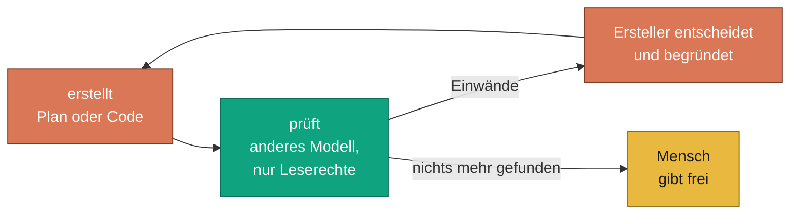
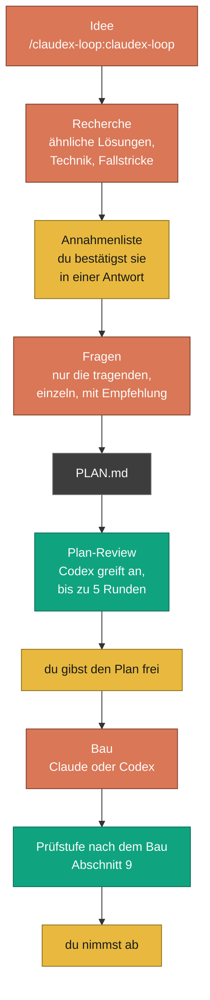
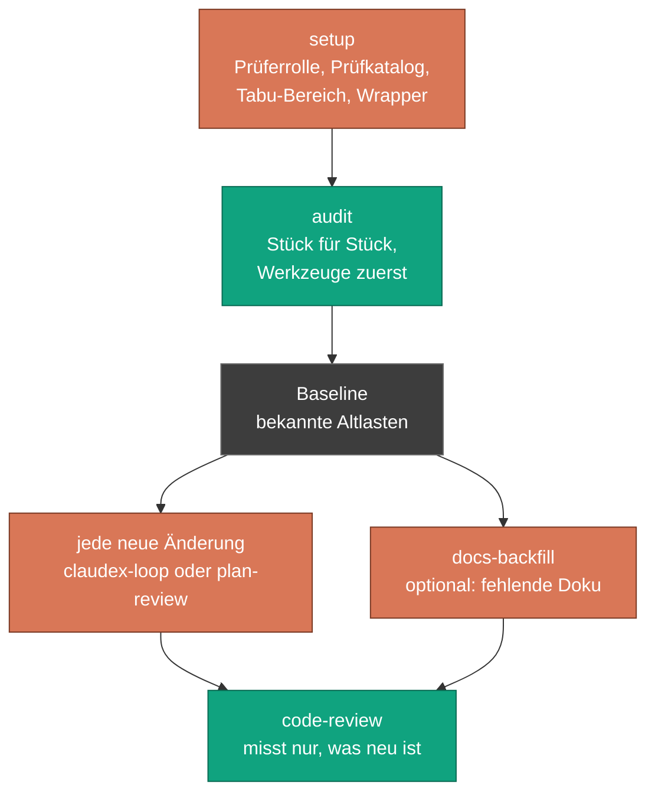
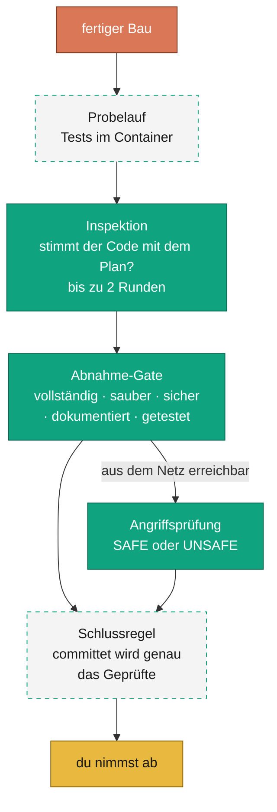
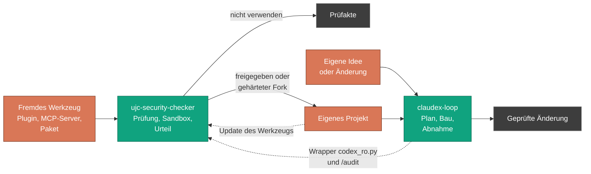

<!-- freigabe: offen -->
# claudex-loop: Einstieg

[English](getting-started.md) | [Deutsch](einstieg.md)

Diese Seite erklärt claudex-loop für Leute, die es zum ersten Mal sehen: was es tut, wofür es
gut ist, wie man es einsetzt und wo seine Grenzen liegen. Sie setzt kein Vorwissen über die
eingesetzten Werkzeuge voraus. Wer tiefer einsteigen will, findet Verweise auf die technische Doku
im Text und gesammelt unter [Weiterlesen](#16-weiterlesen).

**Inhalt**

1. [Worum geht es?](#1-worum-geht-es)
2. [Warum braucht man so etwas heute?](#2-warum-braucht-man-so-etwas-heute)
3. [Das Grundprinzip: Wer etwas macht, prüft es nie selbst](#3-das-grundprinzip-wer-etwas-macht-prüft-es-nie-selbst)
4. [Die Werkzeuge und wofür sie da sind](#4-die-werkzeuge-und-wofür-sie-da-sind)
5. [Die Bausteine des Plugins](#5-die-bausteine-des-plugins)
6. [Neues Projekt (Greenfield)](#6-neues-projekt-greenfield)
7. [Bestehendes Projekt (Brownfield)](#7-bestehendes-projekt-brownfield)
8. [Sauber entwickeln: so arbeitet man damit](#8-sauber-entwickeln-so-arbeitet-man-damit)
9. [Wie der Bau danach geprüft wird](#9-wie-der-bau-danach-geprüft-wird)
10. [Wie angegriffen und getestet wird](#10-wie-angegriffen-und-getestet-wird)
11. [Einbinden: Voraussetzungen, Installation, erster Lauf](#11-einbinden-voraussetzungen-installation-erster-lauf)
12. [Was es kostet und was man wissen muss](#12-was-es-kostet-und-was-man-wissen-muss)
13. [Das Schwesterprojekt ujc-security-checker](#13-das-schwesterprojekt-ujc-security-checker)
14. [Was es nicht ist](#14-was-es-nicht-ist)
15. [Begriffe](#15-begriffe)
16. [Weiterlesen](#16-weiterlesen)

---

## 1. Worum geht es?

claudex-loop ist eine Erweiterung (ein *Plugin*) für **Claude Code**, den Programmierassistenten
von Anthropic. Es lässt zwei KI-Modelle verschiedener Anbieter gegeneinander arbeiten: Eines
schreibt, das andere prüft. Das prüfende Modell ist **OpenAI Codex**. Es bekommt nur Leserechte
und hat eine klare Aufgabe: Fehler finden.

Das passiert an mehreren Stellen:

- **Vor der ersten Zeile Code** wird der Plan angegriffen. Fehler in einem Plan kosten Minuten,
  dieselben Fehler im fertigen Code kosten Tage.
- **Nach dem Bau** prüft das andere Modell den fertigen Code gegen den Plan: Ist alles da, ist es
  sauber, ist es sicher, ist es dokumentiert, taugen die Tests?
- **Bei bestehender Software**, die nie jemand geprüft hat, erstellt es eine Bestandsaufnahme
  (Audit), auf der spätere Prüfungen aufbauen.

Der Mensch bleibt an den Stellen, an denen entschieden wird: Er bestätigt die Annahmen, beantwortet
die wichtigen Fragen, gibt den Plan frei und nimmt das Ergebnis ab. Alles dazwischen läuft
automatisch und wird in einer Protokolldatei festgehalten.

> **Für Entwickler in einem Satz:** Claude Code plant und baut, Codex CLI reviewt read-only über
> einen gehärteten Wrapper, Rollen und Gates verhindern Selbstbewertung, und jeder Schritt
> hinterlässt prüfbare Artefakte (`PLAN.md`, `PLAN-REVIEW-LOG.md`, Audit-Baseline).

## 2. Warum braucht man so etwas heute?

### Die Lage

KI-Assistenten schreiben inzwischen große Teile von Software. Sie sind schnell, gründlich im
Detail und klingen immer überzeugt. Genau das ist das Problem: Ein Modell, das einen Plan
geschrieben hat, findet seine eigenen Denkfehler schlecht. Es bestätigt sich selbst. Fragt man
es, ob der Plan gut ist, sagt es meistens ja.

### Die Gefahren

| Gefahr | Wie es sich zeigt |
|---|---|
| **Plausible, aber falsche Pläne** | Ein Plan liest sich fertig und enthält trotzdem Teile, die sich nicht bauen lassen oder Daten zerstören. Im ersten echten Lauf dieses Projekts waren es ein nicht baubares Teilsystem und sechs Entwürfe, die Daten beschädigt hätten, in einem gründlich recherchierten Plan. |
| **Selbstbestätigung** | Wer den Code schrieb, prüft ihn mit denselben blinden Flecken. Ein „sieht gut aus“ vom selben Modell ist keine Prüfung. |
| **Sicherheitslücken** | KI-Code enthält dieselben Klassen von Fehlern wie menschlicher: fehlende Anmeldung an einer Schnittstelle, Passwörter im Code, ungeprüfte Eingaben. Nur entsteht er schneller, also auch die Fehler. |
| **Ungewollte Aktionen der KI** | Ein Assistent mit Schreibrechten und Internetzugang kann Dateien ändern, Befehle ausführen und Daten nach außen schicken. Ein Prüfer sollte das gar nicht können. |
| **Datenabfluss** | Alles, was ein Cloud-Modell liest, verlässt den Rechner. Ohne klare Regeln landen auch Zugangsdaten oder Kundendaten im Prompt. |
| **Stille Fehlschläge** | Eine Prüfung, die gar nicht stattfand, sieht oft genauso aus wie eine bestandene: kein Fehler, eine flüssige Antwort, ein grüner Haken. |

### Die Chancen und der Nutzen

- **Fehler früh und billig finden.** Ein zweites Modell eines anderen Anbieters hat andere blinde
  Flecken. Es findet, was das erste übersieht, bevor Code existiert.
- **Nachvollziehbarkeit.** Jede Runde, jeder Einwand und jede Entscheidung steht in einer Datei.
  Man kann später nachlesen, *warum* etwas so gebaut wurde.
- **Sicherheit als fester Schritt.** Sicherheitsprüfung, Schwachstellen-Scanner und für alles,
  was aus dem Netz erreichbar ist, eine eigene Angriffsprüfung laufen bei jeder Änderung mit,
  nicht erst, wenn jemand daran denkt.
- **Kontrollierter Einsatz von KI.** Prüfer laufen ohne Schreibrechte, fremder Code läuft nur in
  einem abgeschotteten Container, und was an den Cloud-Anbieter geht, legt man vorab fest.
- **Bestehende Software beherrschbar machen.** Ein Audit erzeugt eine Liste der vorhandenen
  Altlasten. Danach wird jede Änderung nur noch daran gemessen, was sie neu einbringt.

## 3. Das Grundprinzip: Wer etwas macht, prüft es nie selbst

Das ist die eine Regel, auf der alles aufbaut. Sie gilt in jede Richtung:

- Plan von Claude: Codex greift ihn an.
- Code von Claude: Codex prüft ihn.
- Code von Codex: Claude liest ihn vollständig und lässt die Tests laufen.

Wer welche Rolle hat, ist **Konfiguration** (Datei `.claudex.yaml`), kein fester Name. Ein
Prüfprogramm lehnt jede Einstellung ab, in der jemand seine eigene Arbeit bewerten würde oder ein
Prüfer Schreibrechte hätte. Das ist kein Warnhinweis: Der Lauf startet dann gar nicht.



Die Farben stehen in der ganzen Doku für dasselbe: **Orange** erstellt, **Grün** prüft,
**Gelb** ist der Mensch, **Grau** ist eine Datei, **gestrichelt** ist ein abgeschotteter Bereich.

Der Ersteller muss nicht jeden Einwand übernehmen. Er darf ablehnen, muss die Ablehnung aber
begründen, und die Begründung steht im Protokoll. Die Zahl der Runden ist begrenzt (Vorgabe: 5).
Einigen sich die Modelle nicht, entscheidet der Mensch, und das Protokoll sagt, dass keine Einigung
erreicht wurde.

## 4. Die Werkzeuge und wofür sie da sind

| Werkzeug | Was es ist | Wofür claudex-loop es nutzt |
|---|---|---|
| **Claude Code** | Programmierassistent von Anthropic im Terminal oder in VS Code | Führt das Gespräch, plant, baut, steuert die Abläufe, entscheidet über Einwände |
| **OpenAI Codex CLI** | Kommandozeilen-Werkzeug von OpenAI | Der Gegenspieler: prüft Pläne und Code, immer nur lesend. Kann auch bauen, dann in einem Container |
| **Das Plugin claudex-loop** | Diese Erweiterung: Skills, Skripte, Hooks, Tests | Legt die Abläufe fest und setzt sie durch (Abschnitt 5) |
| **Docker** | Container-Laufzeit | Führt fremden Code, Tests und den Codex-Bau abgeschottet aus, ohne Zugriff auf den Rechner. Tests laufen ohne Netz, der Codex-Bau erreicht nur den Modelldienst |
| **gitleaks** | Scanner für Zugangsdaten im Code | Findet Passwörter und Schlüssel, bevor sie in einem Prompt landen |
| **grype** | Schwachstellen-Scanner | Prüft Abhängigkeiten und Images auf bekannte Lücken |
| **hadolint**, **actionlint** | Prüfer für Dockerfiles und GitHub-Workflows | Laufen, wenn eine Änderung solche Dateien betrifft |
| **OSV** (osv.dev) | Öffentliche Datenbank bekannter Schwachstellen | Abgleich der genauen Paketversionen, ohne ein Paketwerkzeug auf dem Rechner |
| **Cloudflare security-audit** | Veröffentlichte Methode für Sicherheitsjagden | Grundlage der Sicherheitsjagd im Audit, aus einer festgelegten, geprüften Fassung gelesen |
| *optional:* LM Studio, Ollama, OpenRouter u. a. | Lokale oder andere Cloud-Modelle | Ersatzprüfer, wenn das Codex-Kontingent aufgebraucht ist. Nie automatisch, immer auf Entscheidung des Menschen |
| *optional:* CodeRabbit | Kommerzieller Review-Dienst | Zusätzlicher dritter Prüfer im Abnahme-Gate, standardmäßig aus |

> **Für Entwickler:** Alle Codex-Aufrufe laufen über einen Wrapper (`tools/codex_ro.py`), der
> Read-only erzwingt, Benutzer-Konfiguration, MCP-Server, Apps, Plugins und Websuche abschaltet und
> mit eigenen Exit-Codes meldet, wenn der Prüfer nichts lesen konnte (3) oder der Durchgang nicht
> read-only lief (4). Details: [README, Safety](../README_DE.md#sicherheit).

## 5. Die Bausteine des Plugins

Ein *Skill* ist eine Anleitung, die Claude Code auf Zuruf ausführt, etwa mit
`/claudex-loop:audit`. Man kann die Skills auch in normaler Sprache auslösen („prüf diesen Plan
mit Codex").

| Skill | Wann man ihn nutzt | Was am Ende dasteht |
|---|---|---|
| **`claudex-loop`** | Etwas Neues soll entstehen, und es ist wichtig, dass es stimmt | Ein geprüfter Plan, auf Wunsch der fertige und geprüfte Code |
| **`plan-review`** | Es gibt schon einen Plan, er soll nur noch angegriffen werden | Ein geprüfter Plan mit Protokoll |
| **`build`** | Codex soll bauen statt Claude | Code aus einem Container, den Claude vor der Übernahme Seite für Seite liest |
| **`code-review`** | Fertiger Code soll abgenommen werden | Je ein Urteil zu Vollständigkeit, Qualität, Sicherheit, Doku und Tests, dazu bei Netzbezug eine Angriffsprüfung |
| **`audit`** | Bestehende Software, die nie geprüft wurde | Eine Bestandsaufnahme (Baseline) mit priorisierten Befunden, auf Wunsch eine Sicherheitsjagd |
| **`docs-backfill`** | Die Code-Dokumentation fehlt oder ist dünn | Ergänzte Dokumentation, deren Richtigkeit ein zweites Modell geprüft hat |
| **`setup`** | Ein Projekt soll claudex-loop nutzen | Ein eingerichtetes Projekt, bestätigt durch einen echten Prüfaufruf |

Dazu kommen Teile, die man nicht selbst aufruft, die aber immer mitlaufen:

- **Der Wrapper** (`codex_ro.py`): der einzige Weg, auf dem Codex aufgerufen wird.
- **Der Wächter** (`wrapper_guard.py`): sorgt dafür, dass an einen freigegebenen Prüfaufruf kein
  zweiter Befehl angehängt wird.
- **Die Rollenprüfung** (`claudex_roles.py`): verhindert Selbstbewertung und Prüfer mit
  Schreibrechten.
- **Der Container-Runner** (`sandbox_run.py`): führt den Code des geprüften Projekts nur in einem
  Wegwerf-Container aus.
- **Die Erinnerung** (`gate_reminder.py`): weist beim Commit darauf hin, wenn das Abnahme-Gate eines
  Plans noch offen ist.

## 6. Neues Projekt (Greenfield)

Greenfield heißt: Es gibt noch keinen Code, oder nur sehr wenig. Hier bringt claudex-loop am
meisten, weil die teuersten Fehler in der Planung entstehen.



**So läuft es ab:**

1. **Idee nennen.** In Claude Code `/claudex-loop:claudex-loop` aufrufen und beschreiben, was
   entstehen soll. Wie gründlich vorab recherchiert wird, entscheidest du: gar nicht, kurz im Web
   oder ausführlich mit mehreren Agenten (`research=none|web|deep`).
2. **Annahmen bestätigen.** Claude legt eine Liste aller Punkte vor, die es schon für geklärt hält.
   Du bestätigst oder korrigierst sie in einer einzigen Antwort.
3. **Die wichtigen Fragen beantworten.** Offene Entscheidungen werden sortiert: Die tragenden
   kommen einzeln, jeweils mit Begründung, einer Empfehlung und der Angabe, was schiefgeht, wenn
   man falsch rät. Kleinkram kommt gesammelt, und du widersprichst nur, wo nötig. Wer will, sagt
   „nimm bei allen restlichen Fragen die Empfehlung“.
4. **Plan-Review.** Der fertige Plan geht an Codex. Codex antwortet mit konkreten Einwänden und
   einem Urteil (`APPROVED` oder `REVISE`). Claude überarbeitet und schickt den Plan in **dieselbe**
   Codex-Sitzung zurück, damit Codex sich an seine früheren Einwände erinnert und prüft, ob sie
   wirklich behoben sind.
5. **Freigabe.** Du liest den Plan und gibst ihn frei. Vorher wird kein Code geschrieben.
6. **Bau und Prüfung** (optional): siehe Abschnitte 8 und 9.

## 7. Bestehendes Projekt (Brownfield)

Brownfield heißt: Es gibt Code, oft schon Jahre alt, oft ohne geregelte Prüfung. Hier ist die
Reihenfolge eine andere: erst einrichten, dann eine Bestandsaufnahme, dann jede neue Änderung
wie bei Greenfield.



**So läuft es ab:**

1. **Einrichten mit `setup`.** Der Skill sieht sich das Projekt an und legt fest:
   - **Die Prüferrolle** in `AGENTS.md`. Codex liest diese Datei automatisch.
   - **Einen Prüfkatalog** mit 6 bis 10 Punkten, die aus *diesem* Projekt stammen: die Fallstricke,
     die hier schon einmal Probleme gemacht haben. Allgemeine Punkte, die in jedem Projekt gelten
     würden, gehören nicht hinein.
   - **Den Tabu-Bereich**, die wichtigste Entscheidung: Was darf Codex nicht lesen? Denn alles, was
     es liest, geht an OpenAI. Typisch sind `.env`-Dateien, Zugangsdaten, Datenordner und
     Kundenverzeichnisse.
   - **Eine Kopie des Wrappers** unter `tools/codex_ro.py` sowie die Einträge für `.gitignore` und
     die Codex-Vertrauensliste.
   - **Eine Bestätigung durch einen echten Prüfaufruf.** „Müsste jetzt gehen“ gilt nicht als
     eingerichtet.
2. **Bestandsaufnahme mit `audit`.** Das Projekt wird in prüfbare Stücke geteilt. Zuerst laufen die
   maschinellen Prüfer (Linter, Scanner), denn was ein Werkzeug in einer Sekunde findet, soll kein
   Modell suchen müssen. Dann prüft für jedes Stück eine frische Codex-Sitzung Sicherheit, Qualität,
   Doku, Tests und die Einhaltung der Projektregeln. Jede Komponente, die aus dem Netz erreichbar
   ist, bekommt zusätzlich eine eigene Angriffsprüfung. Was nicht geprüft wurde, steht ausdrücklich
   im Bericht.
3. **Die Baseline.** Das Ergebnis ist eine Datei `docs/audit/<Datum>-baseline.md` mit allen
   gefundenen Altlasten, nach Dringlichkeit sortiert. Sie ist der Nullpunkt: Spätere Prüfungen
   bringen einen Befund daraus nur dann erneut vor, wenn eine Änderung ihn verschlimmert oder den
   betroffenen Code anfasst. So geht ein neuer, echter Fehler nicht in hundert alten unter.
4. **Optional `docs-backfill`.** Fehlende Code-Dokumentation wird ergänzt. Claude schreibt sie, ein
   zweites Modell prüft, ob sie *stimmt*. Eine falsche Dokumentation ist schlimmer als keine.
5. **Ab jetzt jede Änderung** mit `claudex-loop` (größere, wichtige Vorhaben) oder `plan-review`
   (wenn der Plan schon steht), dann `code-review`.

## 8. Sauber entwickeln: so arbeitet man damit

**Wann lohnt sich der volle Ablauf?** Bei allem, was teuer wird, wenn es schiefgeht:
Anmeldung und Berechtigungen, Datenmodelle und Migrationen, Nebenläufigkeit, Zahlungen,
Schnittstellen nach außen, Architekturentscheidungen. Für einen Tippfehler oder eine kleine
Anpassung ist er zu viel. Dafür reicht ein normaler Commit oder höchstens ein `code-review`.

**Was einen guten Plan ausmacht.** Jeder Plan hat dieselben Abschnitte: Ziel, Vorgehen, die
strittigen Entscheidungen, Nachweis, Risiken und was ausdrücklich nicht dazugehört. Zwei davon
werden oft unterschätzt:

- **Strittige Entscheidungen offen benennen.** Was nicht im Plan steht, kann der Prüfer nicht
  angreifen.
- **Der Nachweis (Verification).** Wie zeigt der Bau, dass er funktioniert? Mit echten Daten und
  echten Aufrufen, nicht nur mit Testdaten, die genau auf die neue Regel zugeschnitten sind. Wird
  bestehendes Verhalten geändert: alten und neuen Code mit denselben Eingaben laufen lassen und die
  gewollten Unterschiede benennen. Jeder andere Unterschied ist ein Befund.

**Was im Repo entsteht:**

| Datei | Inhalt |
|---|---|
| `PLAN.md` | Das *Was*: der freigegebene Plan, mit einer Zeile `claudex-gate: pending; due-after: <Schritt>`, die festhält, nach welchem Schritt die Abnahme fällig ist |
| `PLAN-REVIEW-LOG.md` | Das *Warum*: jede Runde, jeder Einwand, jede Entscheidung mit Begründung |
| `docs/audit/…-baseline.md` | Bei Brownfield: die Altlasten als Nullpunkt |

**Gute Gewohnheiten, die das Werkzeug unterstützt:**

- Jede behobene Lücke bekommt einen Test, der vorher rot war. Ein Test, der nie fehlschlagen
  konnte, beweist nichts.
- Ein Commit am Ende einer Arbeitseinheit, nicht nach jedem Teilschritt.
- Ein Plan, der sich während des Baus ändert, wird in `PLAN.md` geändert und dem Menschen als
  Planänderung vorgelegt, nicht still im Code korrigiert.

## 9. Wie der Bau danach geprüft wird

Das ist die Stufe, die der Code durchläuft, bevor er in das Projekt übernommen wird. Sie hat drei
voneinander unabhängige Prüfungen und eine Schlussregel.



1. **Probelauf im Container.** Die Tests des Projekts laufen in einem Wegwerf-Container: ohne Netz,
   ohne Zugriff auf den Rechner, auf genau dem Stand, der geprüft wird. Nur ein sauberes Ende mit
   Exit 0 zählt als bestanden, Zeitüberschreitung oder Speichermangel nie. Gibt es kein Docker,
   wird der Schritt verweigert. Es gibt keinen Ausweg „dann eben auf dem Rechner“.
2. **Inspektion.** Eine frische Codex-Sitzung, die weder den Plan noch den Bau mitgemacht hat,
   prüft: Setzt der Code den Plan richtig um? Sie bekommt jede geänderte Datei vollständig und
   achtet besonders auf Tests, die nur bestätigen, was der Code ohnehin tut. Bis zu zwei Runden.
3. **Abnahme-Gate (`code-review`).** Eine weitere frische Sitzung urteilt getrennt in fünf
   Dimensionen, jede mit eigener Urteilszeile:
   - `DOD`: Ist alles umgesetzt, was der Plan verlangt? Fehlt etwas, oder kam Ungefragtes dazu?
   - `QUALITY`: Lesbarkeit, Benennung, Fehlerbehandlung, Dokumentation, die nicht zum Code passt
   - `SECURITY`: Anmeldung und Berechtigung, Zugangsdaten, Einschleusung, Pfade, Abhängigkeiten
   - `DOCS`: Ist alles Neue dokumentiert, und sind README und Betriebsdoku nachgezogen?
   - `TESTS`: Wird jeder geänderte Pfad getestet, auch Fehlerfälle und Grenzwerte, und würden die
     Tests fehlschlagen, wenn der Code falsch wäre?

   Vorher laufen die Scanner (gitleaks, bei Bedarf grype, hadolint, actionlint), und ihr Ergebnis
   geht als Beleg in die Prüfung ein. Gefundenes wird behoben, dann bis zu zwei Nachprüfungen.
4. **Angriffsprüfung (Exposure Pass).** Berührt die Änderung etwas, das aus dem Netz erreichbar
   ist (Schnittstellen, Anmeldung, Webhooks, offene Ports, Proxy- oder Tunnel-Einstellungen), prüft
   eine eigene Sitzung mit eigenem Modell: Kann jemand von außen etwas erreichen, fälschen,
   einschleusen oder lesen, was er nicht soll? Im Zweifel gilt etwas als erreichbar. `UNSAFE`
   blockiert den Commit.
5. **Schlussregel.** Geprüft wird der vorgemerkte Stand (der *Index*). Vor dem Commit vergleicht
   ein Skript (`tree_check.py`), ob sich danach etwas geändert hat. Erlaubt sind nur zwei Dinge:
   das Protokoll ist gewachsen, und die Gate-Zeile im Plan wurde auf `done` gesetzt. Jede andere
   Änderung verhindert, dass der Commit als geprüft gilt.

Baut Codex statt Claude, laufen dieselben Prüfungen. Davor kommt noch ein Schritt: Codex baut in
einem frischen Container, das Ergebnis liegt in einer Quarantäne, und Claude liest jede
Zusammenfassung und jede Dateiseite, bevor etwas in das Projekt übernommen wird. Der Container
erreicht nur den Modelldienst, über einen eng gerouteten Proxy. Im Container liegt nur ein
Platzhalter, das echte Zugangstoken setzt der Proxy außerhalb ein.

## 10. Wie angegriffen und getestet wird

„Angreifen“ heißt hier: Ein Modell bekommt die ausdrückliche Rolle des Gegners. Lob ist nicht
gefragt. Jeder Einwand braucht eine konkrete Stelle (Datei und Zeile oder eine Regel aus dem
Prüfkatalog) und die Aussage, was genau schiefgeht, wenn es so bleibt.

| Wo | Wer greift an | Was gesucht wird |
|---|---|---|
| **Plan-Review** | Codex, nur lesend | Denkfehler, Wettlaufsituationen, fehlende Fälle, falsche Annahmen, Sicherheitslücken, einfachere Wege. Ausdrücklich auch: alle Stellen im Code, die dieselbe Ressource beschreiben, nicht nur die im Plan genannten |
| **Inspektion und Abnahme** | frische Codex-Sitzungen | Abweichungen vom Plan, unsauberer Code, Lücken in Sicherheit, Doku und Tests |
| **Angriffsprüfung** | eigene Rolle, eigenes Modell | Alles, was von außen erreichbar ist, nach einer festen Checkliste |
| **Sicherheitsjagd im Audit** | Analyse-Agenten **ohne Werkzeuge**, dann das andere Modell | Angriffsklassen nach der Methode von Cloudflare. Gearbeitet wird auf einer eingefrorenen Kopie, in der Zugangsdaten unkenntlich gemacht sind. Jeder Fund wird vom anderen Modell unvoreingenommen nachgeprüft und in einem Protokoll festgehalten, das nur wachsen kann |
| **Tests** | im Container | Die Tests des Projekts selbst, auf genau dem geprüften Stand |

**Wie man einer Prüfung trauen kann.** Eine Prüfung, die nicht stattfand, darf nicht wie eine
bestandene aussehen. Deshalb:

- Eine Antwort zählt nur, wenn ihre letzte Zeile ein gültiges Urteil ist. Eine leere Antwort ist
  ein Fehler, kein stilles „alles gut“.
- Konnte der Prüfer keine einzige Datei lesen, meldet der Wrapper Exit 3: Die Runde ist ungültig,
  egal was in der Antwort steht. Das ist kein theoretischer Fall: Unter Windows lehnte Codex
  monatelang jeden Lesebefehl ab und schrieb trotzdem flüssige Gutachten, allein aus dem Prompt.
- Zeigt das Sitzungsprotokoll von Codex, dass der Durchgang nicht nur lesend lief, meldet der
  Wrapper Exit 4. Auch diese Runde ist ungültig.
- Ist das Kontingent erschöpft, hält der Ablauf an, und der Mensch entscheidet: warten, auf einen
  Ersatzprüfer wechseln (im Protokoll als solcher gekennzeichnet) oder ohne Gegenprüfung
  weitermachen (im Plan als „nicht gegengeprüft“ vermerkt).

**Das Projekt selbst wird genauso geprüft.** claudex-loop hat seine eigenen Werkzeuge gegen sich
selbst gerichtet. Das erste Audit fand die beiden wichtigsten Schutzmechanismen umgehbar. Beide
wurden geschlossen, jeweils mit einem Test, der vorher rot war. Heute laufen rund 1.600 Tests auf
Linux, macOS und Windows, dazu Prüfungen mit shellcheck, actionlint, gitleaks, bandit und
pip-audit.

## 11. Einbinden: Voraussetzungen, Installation, erster Lauf

### Voraussetzungen (einmal je Rechner)

| Was | Wozu | Hinweis |
|---|---|---|
| **Claude Code** | Hier läuft das Plugin | Terminal oder VS Code |
| **Codex CLI 0.162.1 oder neuer** | Der Prüfer | Mit fester Version installieren, siehe unten |
| **`codex login`** | Anmeldung bei OpenAI | Ein ChatGPT-Konto genügt (Free, Plus, Pro, Max) |
| **Python 3.10 oder neuer** | Die Skripte des Plugins | Nur Standardbibliothek |
| **Docker** (Linux-Engine) und das Test-Image | Tests und Bau im Container | Das Image baut ein Mensch einmal selbst, die Anleitung steht in [`docs/betrieb.md`](betrieb.md). Ohne Docker werden diese Schritte verweigert |
| **git** | Projektstand, Diffs, Prüfbindung | Das Projekt sollte ein git-Repository sein |

```bash
npm install -g @openai/codex@0.162.1
codex login
```

### Installation des Plugins (in Claude Code)

```
/plugin marketplace add ujconsulting/claudex-loop
/plugin install claudex-loop@claudex-loop
```

Danach Claude Code neu starten. Skills und Hooks werden beim Sitzungsstart gelesen. Im Menü
`/plugin` lässt sich die automatische Aktualisierung einschalten.

### Ein Projekt einrichten

Die Claude-Code-Sitzung **im Projektordner starten** (nicht später mit `cd` wechseln) und
aufrufen:

```
/claudex-loop:setup target=<absoluter Pfad zum Projekt>
```

`setup` fragt nach, was es nicht selbst herausfinden kann, vor allem nach dem Tabu-Bereich. Am Ende
steht ein echter Prüfaufruf, der antworten muss. Erst dann ist das Projekt eingerichtet.

### Der erste Lauf

| Lage | Aufruf |
|---|---|
| Neues Vorhaben, Plan fehlt noch | `/claudex-loop:claudex-loop` |
| Plan liegt schon vor | `/claudex-loop:plan-review` |
| Bestehendes Projekt kennenlernen | `/claudex-loop:audit` |
| Fertige Änderung abnehmen | `/claudex-loop:code-review scope=dod,quality,security,docs,tests` |

Alle Einstellmöglichkeiten (Rundenzahl, Prüfumfang, Dateinamen) stehen in der Tabelle
[Stellschrauben im README](../README_DE.md#stellschrauben).

### Wer welche Rolle hat

Ohne eigene Einstellung plant und baut Claude, und Codex prüft. Wer es anders will, legt im Projekt
eine Datei `.claudex.yaml` an, etwa damit Codex baut und Claude prüft. Die Rollenprüfung lehnt
jede Einstellung ab, die das Grundprinzip verletzt. Einzelheiten: [`ROLES.md`](../ROLES.md).

## 12. Was es kostet und was man wissen muss

- **Abonnements.** Es braucht Zugang zu Claude Code und ein ChatGPT-Konto für Codex. Das Plugin
  selbst ist frei (MIT-Lizenz).
- **Kontingent.** Jede Prüfrunde verbraucht Codex-Kontingent. Eine echte Plan-Review-Runde dauert
  einige Minuten (gemessen rund 5). `scripts/codex_usage.py` zeigt, wie viel noch übrig ist und
  wann es sich erneuert.
- **Daten verlassen den Rechner.** Was Codex liest, geht an OpenAI. Was Claude liest, geht an
  Anthropic. Der Tabu-Bereich legt fest, was der Prüfer nicht öffnen darf. Er ist eine Anweisung an
  das Modell, keine technische Sperre, deshalb gehören echte Geheimnisse ohnehin nicht in das
  Projektverzeichnis. Für Abhängigkeitsprüfungen gehen zusätzlich Paketnamen und Versionen an
  `pypi.org` und `api.osv.dev`.
- **Zeit.** Der volle Ablauf mit Interview, mehreren Review-Runden, Bau und Abnahme dauert länger
  als einfach losprogrammieren. Er spart die Zeit dort, wo sonst Nacharbeit, Fehlersuche in
  Produktion oder ein Sicherheitsvorfall anfallen würde.
- **Betriebssysteme.** Windows, macOS und Linux. Unter Windows braucht Codex ab Version 0.147
  mindestens Wrapper 2.4.0, sonst liest der Prüfer nichts. Der Wrapper bricht in diesem Fall mit
  Exit 3 ab.

## 13. Das Schwesterprojekt ujc-security-checker

claudex-loop prüft, was **Sie selbst** bauen: den Plan und die Änderung. Woher die Werkzeuge
kommen, die dabei auf dem Rechner laufen, prüft es nicht. Ein Claude-Code-Plugin, ein Skill, ein
MCP-Server, ein Kommandozeilenwerkzeug von GitHub, ein Python- oder npm-Paket läuft mit den Rechten
des Entwicklers und kann alles lesen, was er lesen kann. Dafür gibt es
[ujc-security-checker](https://github.com/ujconsulting/ujc-security-checker), eine Prüfstation
für fremde Werkzeuge, bevor sie installiert werden.

Beide folgen demselben Grundsatz, prüfen aber verschiedene Dinge:

| | claudex-loop | ujc-security-checker |
|---|---|---|
| **Was geprüft wird** | Der eigene Plan und die eigene Änderung, während sie entstehen | Ein fremdes Werkzeug, bevor es installiert wird |
| **Wann** | Vor dem Bau (Plan-Review) und danach (Inspektion, Abnahme-Gate) | Vor dem ersten Einsatz und nach jedem Update des Originals |
| **Ergebnis** | Ein freigegebener Plan, eine abgenommene Änderung, eine Baseline der Altlasten | Eine Prüfakte mit Urteil je Werkzeug, bei Bedarf ein gehärteter privater Fork, bei Bedarf eine Meldung an das Originalprojekt |
| **Fremder Code läuft** | Eigener Code nur im abgeschotteten Container | Nie auf dem Rechner. Nach Freigabe einmal im Container, installiert nur über einen Proxy mit Positivliste, danach ohne Netz und unter Beobachtung |
| **Verlässt den Rechner** | Nur, was die Prüfer lesen | Meldungen an das Originalprojekt, nur mit einer Freigabe, die an den Hash genau dieses Textes gebunden ist |



So greifen sie ineinander:

- **Erst der Checker, dann der Einbau.** Ein Werkzeug, das Teil eines Projekts werden soll
  (Abhängigkeit, Plugin, MCP-Server), läuft zuerst durch den Checker. Erst danach wird es
  eingebaut, und diese Änderung läuft durch claudex-loop.
- **Der Checker nutzt Teile von claudex-loop.** Jeder Codex-Aufruf dort geht über denselben
  Read-only-Wrapper (`tools/codex_ro.py` ist eine Kopie). Auf Wunsch übernimmt der Skill `/audit`
  die Codex-Hälfte der Erstprüfung.
- **Die Abhängigkeitsprüfung von claudex-loop ersetzt den Checker nicht.** Sie listet bekannte
  Schwachstellen in den Abhängigkeiten eines Projekts. Ob ein Paket bösartig ist oder was es beim
  Installieren tut, beantwortet sie nicht. Das ist Aufgabe des Checkers: Paket gegen Quelle,
  Heuristiken für Schadpakete, Verhaltensprobe.

## 14. Was es nicht ist

Damit niemand mehr erwartet, als geliefert wird:

- **Kein Penetrationstest** und kein Ersatz für einen echten Sicherheitsprozess bei
  hochkritischer Software. Es findet viel, aber nicht alles.
- **Keine Garantie.** Zwei Modelle übersehen weniger als eines, aber nicht nichts. Die Abnahme
  bleibt eine menschliche Entscheidung.
- **Keine harte Lesegrenze für den Prüfer.** Read-only heißt: Codex schreibt nicht. Was es im
  Projekt lesen kann, kann es lesen. Die Grenze dafür ist der Tabu-Bereich.
- **Der Container ist keine Hardware-Grenze.** Er läuft auf der Docker-Umgebung des Rechners mit
  strengen Einstellungen (kein Zugriff auf den Rechner, keine Sonderrechte, für Tests kein Netz).
  Das ist deutlich mehr als nichts, aber keine eigene Maschine.
- **Keine Prüfung fremder Werkzeuge.** Ob ein Plugin, ein MCP-Server oder ein Paket überhaupt auf
  den Rechner darf, klärt das Schwesterprojekt ujc-security-checker (Abschnitt 13).

## 15. Begriffe

| Begriff | Bedeutung |
|---|---|
| **Adversary, Gegenspieler** | Das Modell, das prüft und angreift |
| **Audit** | Erstprüfung eines Projekts ohne Vorgeschichte |
| **Baseline** | Die Liste bekannter Altlasten aus dem Audit, der Nullpunkt für spätere Prüfungen |
| **Brownfield / Greenfield** | Bestehendes Projekt / Neubeginn |
| **Container** | Abgeschotteter Wegwerf-Bereich, in dem Code laufen kann, ohne den Rechner zu berühren |
| **DoD (Definition of Done)** | Die Liste, wann etwas als fertig gilt |
| **Exposure Pass, Angriffsprüfung** | Eigene Prüfung für alles, was aus dem Netz erreichbar ist |
| **Gate** | Eine Prüfstufe, die bestanden sein muss, bevor es weitergeht |
| **Hook** | Ein kleines Programm, das Claude Code vor bestimmten Aktionen ausführt, hier als Wächter |
| **Index** | In git der vorgemerkte Stand, der beim nächsten Commit festgeschrieben wird |
| **Quarantäne** | Ablage, in der Code von Codex liegt, bis Claude ihn gelesen hat |
| **Read-only** | Nur Leserechte, keine Schreibrechte |
| **Skill** | Eine Anleitung, die Claude Code auf Zuruf ausführt |
| **Tabu-Bereich** | Was der Prüfer nicht lesen darf, weil es sonst den Rechner verlässt |
| **Wrapper** | Das Programm, über das jeder Codex-Aufruf läuft und das die Regeln durchsetzt |

## 16. Weiterlesen

- [README (Deutsch)](../README_DE.md): was dieses Projekt gegenüber dem Original ergänzt, die
  Ablaufdiagramme jedes Teils, Installation, Sicherheit im Detail
- [`ROLES.md`](../ROLES.md): Rollen und die beiden Sperren gegen Selbstbewertung
- [`FALLBACK.md`](../FALLBACK.md): was passiert, wenn das Codex-Kontingent leer ist
- [`docs/betrieb.md`](betrieb.md): Betriebsanleitung mit gemessenen Werten
- [`SECURITY.md`](../SECURITY.md): Sicherheitslücken vertraulich melden
- [ujc-security-checker](https://github.com/ujconsulting/ujc-security-checker): das Schwesterprojekt,
  das fremde Werkzeuge vor dem Einsatz prüft
