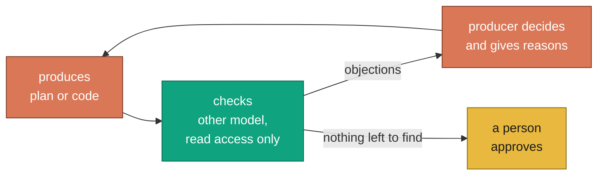
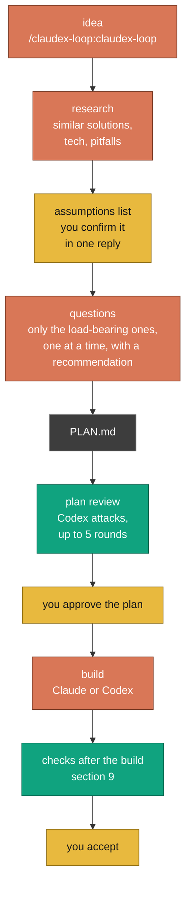
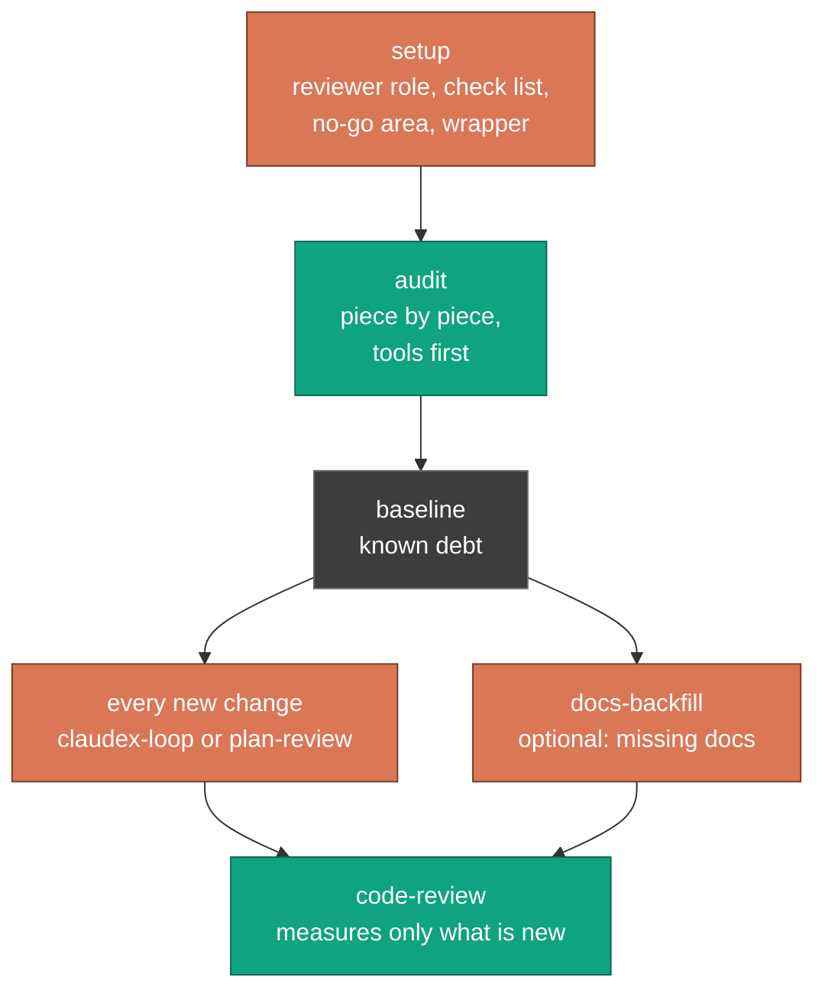
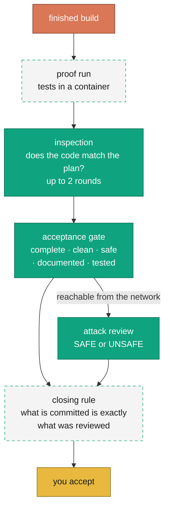
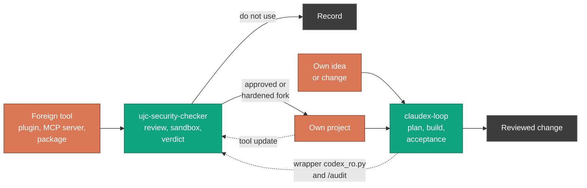

<!-- freigabe: offen -->
# claudex-loop: Getting started

[English](getting-started.md) | [Deutsch](einstieg.md)

This page explains claudex-loop to people seeing it for the first time: what it does, what it is
good for, how to use it and where its limits are. It assumes no prior knowledge of the tools
involved. Pointers to the technical documentation are in the text and collected under
[Further reading](#16-further-reading).

**Contents**

1. [What is it about?](#1-what-is-it-about)
2. [Why does anyone need this today?](#2-why-does-anyone-need-this-today)
3. [The core rule: whoever makes something never checks it](#3-the-core-rule-whoever-makes-something-never-checks-it)
4. [The tools and what they are for](#4-the-tools-and-what-they-are-for)
5. [The building blocks of the plugin](#5-the-building-blocks-of-the-plugin)
6. [New project (greenfield)](#6-new-project-greenfield)
7. [Existing project (brownfield)](#7-existing-project-brownfield)
8. [Building cleanly: how you work with it](#8-building-cleanly-how-you-work-with-it)
9. [How the build is checked afterwards](#9-how-the-build-is-checked-afterwards)
10. [How it is attacked and tested](#10-how-it-is-attacked-and-tested)
11. [Wiring it in: prerequisites, install, first run](#11-wiring-it-in-prerequisites-install-first-run)
12. [What it costs and what you should know](#12-what-it-costs-and-what-you-should-know)
13. [The sister project ujc-security-checker](#13-the-sister-project-ujc-security-checker)
14. [What it is not](#14-what-it-is-not)
15. [Terms](#15-terms)
16. [Further reading](#16-further-reading)

---

## 1. What is it about?

claudex-loop is an extension (a *plugin*) for **Claude Code**, Anthropic's coding assistant. It
sets two AI models from different vendors against each other: one writes, the other checks. The
checking model is **OpenAI Codex**. It gets read access only and one clear job: find what is wrong.

That happens at several points:

- **Before the first line of code**, the plan is attacked. A flaw in a plan costs minutes; the
  same flaw in finished code costs days.
- **After the build**, the other model checks the finished code against the plan: is everything
  there, is it clean, is it safe, is it documented, are the tests any good?
- **For existing software** that nobody ever reviewed, it produces an inventory (an audit) that
  later reviews build on.

People stay where decisions are made: they confirm the assumptions, answer the important
questions, approve the plan and accept the result. Everything in between runs on its own and is
recorded in a log file.

> **For developers, in one sentence:** Claude Code plans and builds, Codex CLI reviews read-only
> through a hardened wrapper, roles and gates rule out self-grading, and every step leaves
> artefacts you can check (`PLAN.md`, `PLAN-REVIEW-LOG.md`, the audit baseline).

## 2. Why does anyone need this today?

### Where things stand

AI assistants now write large parts of software. They are fast, thorough in the details and
always sound sure of themselves. That is the problem: a model that wrote a plan is bad at finding
its own reasoning errors. It confirms itself. Ask it whether the plan is good, and it mostly says
yes.

### The risks

| Risk | How it shows |
|---|---|
| **Plausible but wrong plans** | A plan reads as finished and still contains parts that cannot be built or that destroy data. In this project's first real run there were one unbuildable subsystem and six designs that would have corrupted data, in a thoroughly researched plan. |
| **Self-confirmation** | Whoever wrote the code checks it with the same blind spots. A "looks good" from the same model is not a review. |
| **Security holes** | AI code has the same classes of defect as human code: an endpoint without login, passwords in the source, unchecked input. It is just written faster, and so are the defects. |
| **Unwanted actions by the AI** | An assistant with write access and internet access can change files, run commands and send data out. A reviewer should not be able to do any of that. |
| **Data leaving the machine** | Everything a cloud model reads leaves the computer. Without clear rules, credentials or customer data end up in the prompt too. |
| **Silent failures** | A review that never happened often looks exactly like one that passed: no error, a fluent answer, a green tick. |

### The opportunities and the benefit

- **Find errors early, while they are cheap.** A second model from another vendor has different
  blind spots. It finds what the first one misses, before any code exists.
- **Traceability.** Every round, every objection and every decision is in a file. Later you can
  read *why* something was built the way it was.
- **Security as a fixed step.** A security review, vulnerability scanners and, for anything
  reachable from the network, a dedicated attack review run with every change, not only when
  someone remembers.
- **Using AI under control.** Reviewers run without write access, foreign code runs only in a
  sealed container, and what goes to the cloud vendor is decided up front.
- **Making existing software manageable.** An audit produces a list of the existing debt. After
  that, every change is measured only by what it adds.

## 3. The core rule: whoever makes something never checks it

This is the one rule everything rests on. It applies in every direction:

- Plan by Claude: Codex attacks it.
- Code by Claude: Codex checks it.
- Code by Codex: Claude reads all of it and runs the tests.

Who plays which role is **configuration** (the file `.claudex.yaml`), not a fixed name. A checker
refuses any setting in which someone would grade their own work or a reviewer would have write
access. That is not a warning: the run does not start at all.



The colours mean the same throughout the documentation: **orange** produces, **green** checks,
**yellow** is the person, **grey** is a file, **dashed** is a sealed area.

The producer does not have to accept every objection. It may reject one, but has to give a
reason, and the reason goes into the log. The number of rounds is capped (default: 5). If the
models do not agree, the person decides, and the log says no agreement was reached.

## 4. The tools and what they are for

| Tool | What it is | What claudex-loop uses it for |
|---|---|---|
| **Claude Code** | Anthropic's coding assistant in the terminal or VS Code | Holds the conversation, plans, builds, runs the flows, rules on objections |
| **OpenAI Codex CLI** | OpenAI's command-line tool | The adversary: reviews plans and code, always read-only. It can also build, then inside a container |
| **The claudex-loop plugin** | This extension: skills, scripts, hooks, tests | Defines the flows and enforces them (section 5) |
| **Docker** | Container runtime | Runs foreign code, tests and the Codex build sealed off, without access to the machine. Tests run without network, the Codex build reaches only the model service |
| **gitleaks** | Scanner for credentials in code | Finds passwords and keys before they land in a prompt |
| **grype** | Vulnerability scanner | Checks dependencies and images for known holes |
| **hadolint**, **actionlint** | Checkers for Dockerfiles and GitHub workflows | Run when a change touches such files |
| **OSV** (osv.dev) | Public database of known vulnerabilities | Matches exact package versions, with no package tool on the machine |
| **Cloudflare security-audit** | A published method for security hunts | Basis of the security hunt in the audit, read from a fixed, verified copy |
| *optional:* LM Studio, Ollama, OpenRouter and others | Local or other cloud models | Stand-in reviewers when the Codex quota is used up. Never automatic, always the person's decision |
| *optional:* CodeRabbit | Commercial review service | An extra third reviewer in the acceptance gate, off by default |

> **For developers:** every Codex call goes through a wrapper (`tools/codex_ro.py`) that enforces
> read-only, switches off user config, MCP servers, apps, plugins and web search, and reports with
> its own exit codes when the reviewer could not read anything (3) or the turn did not run
> read-only (4). Details: [README, Safety](../README.md#safety).

## 5. The building blocks of the plugin

A *skill* is a set of instructions Claude Code carries out on request, for example with
`/claudex-loop:audit`. Skills can also be triggered in plain language ("have Codex review this
plan").

| Skill | When to use it | What you have at the end |
|---|---|---|
| **`claudex-loop`** | Something new is to be built, and it matters that it is right | A reviewed plan; on request, the finished and reviewed code |
| **`plan-review`** | A plan exists already and only needs attacking | A reviewed plan with its log |
| **`build`** | Codex should build instead of Claude | Code from a container that Claude reads page by page before it is taken over |
| **`code-review`** | Finished code is to be accepted | One verdict each on completeness, quality, security, docs and tests, plus an attack review where the network is involved |
| **`audit`** | Existing software that was never reviewed | An inventory (baseline) with prioritised findings; on request, a security hunt |
| **`docs-backfill`** | Code documentation is missing or thin | Added documentation whose accuracy a second model has checked |
| **`setup`** | A project should use claudex-loop | A wired-up project, confirmed by a real review call |

Then there are parts you never call yourself but that always run along:

- **The wrapper** (`codex_ro.py`): the only way Codex is ever called.
- **The guard** (`wrapper_guard.py`): makes sure no second command rides along on an approved
  review call.
- **The role check** (`claudex_roles.py`): rules out self-grading and reviewers with write access.
- **The container runner** (`sandbox_run.py`): runs the code of the reviewed project only in a
  throwaway container.
- **The reminder** (`gate_reminder.py`): points out at commit time when a plan's acceptance gate is
  still open.

## 6. New project (greenfield)

Greenfield means there is no code yet, or very little. This is where claudex-loop helps most,
because the most expensive mistakes are made during planning.



**How it runs:**

1. **Name the idea.** In Claude Code, call `/claudex-loop:claudex-loop` and describe what should be
   built. You decide how much research happens first: none, a short web search, or an extensive
   multi-agent one (`research=none|web|deep`).
2. **Confirm the assumptions.** Claude lists everything it already considers settled. You confirm
   or correct it in a single reply.
3. **Answer the important questions.** Open decisions are sorted: the load-bearing ones come one
   at a time, each with a reason, a recommendation and what breaks if the guess is wrong. Minor
   ones come as a batch, and you only object where needed. If you want, say "take the
   recommendation for all remaining questions".
4. **Plan review.** The finished plan goes to Codex. Codex replies with concrete objections and a
   verdict (`APPROVED` or `REVISE`). Claude revises and sends the plan back into the **same** Codex
   session, so Codex remembers its earlier objections and checks whether they were really fixed.
5. **Approval.** You read the plan and approve it. No code is written before that.
6. **Build and checks** (optional): see sections 8 and 9.

## 7. Existing project (brownfield)

Brownfield means there is code, often years old, often without any regular review. The order is
different here: wire it up first, then take an inventory, then treat every new change as in
greenfield.



**How it runs:**

1. **Wire it up with `setup`.** The skill looks at the project and sets up:
   - **The reviewer role** in `AGENTS.md`. Codex reads this file automatically.
   - **A check list** of 6 to 10 points that come from *this* project: the pitfalls that have
     caused trouble here before. Generic points that would apply to any project do not belong in
     it.
   - **The no-go area (taboo scope)**, the most important decision: what must Codex not read?
     Everything it reads goes to OpenAI. Typical entries are `.env` files, credentials, data
     folders and customer directories.
   - **A copy of the wrapper** at `tools/codex_ro.py`, plus the `.gitignore` entries and the Codex
     trust entry.
   - **Confirmation by a real review call.** "Should work now" does not count as set up.
2. **Inventory with `audit`.** The project is split into reviewable pieces. The machine checkers
   (linters, scanners) run first, because what a tool finds in a second no model should have to
   search for. Then, for each piece, a fresh Codex session reviews security, quality, docs, tests
   and conformance to the project's own rules. Every component reachable from the network also
   gets its own attack review. Whatever was not reviewed is stated explicitly in the report.
3. **The baseline.** The result is a file `docs/audit/<date>-baseline.md` listing all existing
   debt, sorted by urgency. It is the zero point: later reviews raise a finding from it again only
   when a change makes it worse or touches the code concerned. That way a new, real defect does
   not drown among a hundred old ones.
4. **Optionally `docs-backfill`.** Missing code documentation is added. Claude writes it, a second
   model checks whether it is *true*. Wrong documentation is worse than none.
5. **From now on, every change** goes through `claudex-loop` (larger, important work) or
   `plan-review` (when the plan already exists), then `code-review`.

## 8. Building cleanly: how you work with it

**When is the full flow worth it?** For anything that gets expensive when it goes wrong: login and
permissions, data models and migrations, concurrency, payments, external interfaces, architecture
decisions. For a typo or a small tweak it is too much; a normal commit or at most a `code-review`
will do.

**What makes a good plan.** Every plan has the same sections: goal, approach, the contestable
decisions, verification, risks, and what is explicitly out of scope. Two of them are often
underrated:

- **Name the contestable decisions openly.** What is not in the plan, the reviewer cannot attack.
- **Verification.** How does the build show that it works? With real data and real calls, not
  only with test data shaped exactly like the new rule. When existing behaviour changes, run old
  and new code on the same inputs and name the intended differences. Any other difference is a
  finding.

**What appears in the repository:**

| File | Contents |
|---|---|
| `PLAN.md` | The *what*: the approved plan, with a line `claudex-gate: pending; due-after: <step>` recording after which step acceptance is due |
| `PLAN-REVIEW-LOG.md` | The *why*: every round, every objection, every decision with its reason |
| `docs/audit/…-baseline.md` | In brownfield: the existing debt as the zero point |

**Good habits the tool supports:**

- Every closed gap gets a test that was red first. A test that could never fail proves nothing.
- One commit at the end of a unit of work, not after every step.
- A plan that changes during the build is changed in `PLAN.md` and shown to the person as a plan
  change, not quietly corrected in the code.

## 9. How the build is checked afterwards

This is the stage the code goes through before it is taken into the project. It has three
independent checks and a closing rule.



1. **Proof run in a container.** The project's tests run in a throwaway container: no network, no
   access to the machine, on exactly the state being reviewed. Only a clean finish with exit 0
   counts as passed, a timeout or running out of memory never does. Without Docker the step is
   refused. There is no "then just run it on the machine".
2. **Inspection.** A fresh Codex session, which took part in neither the plan nor the build,
   checks: does the code implement the plan correctly? It gets every changed file in full and pays
   special attention to tests that only confirm what the code does anyway. Up to two rounds.
3. **Acceptance gate (`code-review`).** Another fresh session judges five dimensions separately,
   each with its own verdict line:
   - `DOD`: is everything the plan asks for implemented? Is something missing, or was something
     unrequested added?
   - `QUALITY`: readability, naming, error handling, documentation that does not match the code
   - `SECURITY`: login and permissions, credentials, injection, paths, dependencies
   - `DOCS`: is everything new documented, and were README and operating docs updated?
   - `TESTS`: is every changed path tested, error cases and boundaries included, and would the
     tests fail if the code were wrong?

   The scanners run first (gitleaks, and grype, hadolint, actionlint where relevant), and their
   output goes into the review as evidence. Findings get fixed, then up to two rechecks.
4. **Attack review (exposure pass).** If the change touches anything reachable from the network
   (interfaces, login, webhooks, open ports, proxy or tunnel settings), a separate session with its
   own model checks: can someone from outside reach, forge, inject or read what they should not?
   When in doubt, something counts as reachable. `UNSAFE` blocks the commit.
5. **Closing rule.** What is reviewed is the staged state (the *index*). Before the commit a script
   (`tree_check.py`) compares whether anything changed since. Only two things are allowed: the log
   grew, and the plan's gate line was set to `done`. Any other change means the commit does not
   count as reviewed.

If Codex builds instead of Claude, the same checks run. One step comes before them: Codex builds
in a fresh container, the result sits in quarantine, and Claude reads every summary and every file
page before anything is taken into the project. The container reaches only the model service,
through a narrowly routed proxy. Inside the container there is only a placeholder; the proxy adds
the real access token outside.

## 10. How it is attacked and tested

"Attacking" here means a model is given the explicit role of the opponent. Praise is not wanted.
Every objection needs a concrete place (file and line, or a rule from the check list) and a
statement of what exactly goes wrong if it stays that way.

| Where | Who attacks | What it looks for |
|---|---|---|
| **Plan review** | Codex, read-only | Reasoning errors, race conditions, missing cases, wrong assumptions, security holes, simpler ways. Explicitly also: every place in the code that writes the same resource, not only those named in the plan |
| **Inspection and acceptance** | fresh Codex sessions | Deviations from the plan, unclean code, gaps in security, docs and tests |
| **Attack review** | its own role, its own model | Everything reachable from outside, along a fixed checklist |
| **Security hunt in the audit** | analysis agents **without tools**, then the other model | Attack classes following Cloudflare's method. The work is done on a frozen copy with credentials blanked out. Every find is re-checked cold by the other model and recorded in a log that can only grow |
| **Tests** | in the container | The project's own tests, on exactly the reviewed state |

**How you can trust a review.** A review that did not happen must not look like one that passed.
So:

- An answer counts only if its last line is a valid verdict. An empty answer is a failure, not a
  silent "all good".
- If the reviewer could not read a single file, the wrapper reports exit 3: the round is invalid,
  whatever the answer says. That is not a theoretical case: on Windows, Codex refused every read
  command for months and still wrote fluent reviews, from the prompt alone.
- If Codex's own session record shows the turn did not run read-only, the wrapper reports exit 4.
  That round is invalid too.
- When the quota is used up, the flow stops and the person decides: wait, switch to a stand-in
  reviewer (marked as such in the log), or carry on without a cross-review (noted in the plan as
  "not cross-reviewed").

**The project is checked the same way.** claudex-loop turned its own tools on itself. The first
audit found its two most important safeguards could be walked around. Both were closed, each with
a test that was red first. Today about 1,600 tests run on Linux, macOS and Windows, plus checks
with shellcheck, actionlint, gitleaks, bandit and pip-audit.

## 11. Wiring it in: prerequisites, install, first run

### Prerequisites (once per machine)

| What | Why | Note |
|---|---|---|
| **Claude Code** | The plugin runs here | Terminal or VS Code |
| **Codex CLI 0.162.1 or newer** | The reviewer | Install a fixed version, see below |
| **`codex login`** | Sign-in with OpenAI | A ChatGPT account is enough (Free, Plus, Pro, Max) |
| **Python 3.10 or newer** | The plugin's scripts | Standard library only |
| **Docker** (Linux engine) and the test image | Tests and build in a container | A person builds the image once; instructions in [`docs/betrieb.md`](betrieb.md) (German). Without Docker these steps are refused |
| **git** | Project state, diffs, binding reviews to a state | The project should be a git repository |

```bash
npm install -g @openai/codex@0.162.1
codex login
```

### Installing the plugin (in Claude Code)

```
/plugin marketplace add ujconsulting/claudex-loop
/plugin install claudex-loop@claudex-loop
```

Then restart Claude Code. Skills and hooks are read at session start. Automatic updates can be
switched on in the `/plugin` menu.

### Wiring up a project

**Start the Claude Code session in the project folder** (do not switch later with `cd`) and call:

```
/claudex-loop:setup target=<absolute path to the project>
```

`setup` asks about what it cannot find out itself, above all the no-go area. It ends with a real
review call that must answer. Only then is the project set up.

### The first run

| Situation | Call |
|---|---|
| New work, no plan yet | `/claudex-loop:claudex-loop` |
| A plan exists already | `/claudex-loop:plan-review` |
| Getting to know an existing project | `/claudex-loop:audit` |
| Accepting a finished change | `/claudex-loop:code-review scope=dod,quality,security,docs,tests` |

All settings (number of rounds, review scope, file names) are in the
[Tunables table in the README](../README.md#tunables).

### Who plays which role

Without any setting of your own, Claude plans and builds and Codex reviews. If you want it
differently, for instance Codex building and Claude reviewing, create a `.claudex.yaml` in the
project. The role check refuses any setting that breaks the core rule. Details:
[`ROLES.md`](../ROLES.md).

## 12. What it costs and what you should know

- **Subscriptions.** You need access to Claude Code and a ChatGPT account for Codex. The plugin
  itself is free (MIT licence).
- **Quota.** Every review round uses Codex quota. A real plan-review round takes a few minutes
  (measured at about 5). `scripts/codex_usage.py` shows how much is left and when it resets.
- **Data leaves the machine.** What Codex reads goes to OpenAI; what Claude reads goes to
  Anthropic. The no-go area sets what the reviewer must not open. It is an instruction to the
  model, not a technical lock, so real secrets do not belong in the project directory anyway. For
  dependency checks, package names and versions also go to `pypi.org` and `api.osv.dev`.
- **Time.** The full flow with interview, several review rounds, build and acceptance takes longer
  than just starting to code. It saves the time where rework, bug hunting in production or a
  security incident would otherwise eat it.
- **Operating systems.** Windows, macOS and Linux. On Windows, Codex 0.147 and later needs at least
  wrapper 2.4.0, or the reviewer reads nothing. The wrapper stops with exit 3 in that case.

## 13. The sister project ujc-security-checker

claudex-loop checks what **you** build: the plan and the change. It does not check where the tools
come from that run on the machine while you build. A Claude Code plugin, a skill, an MCP server, a
command-line tool from GitHub, a Python or npm package runs with the developer's rights and can
read everything the developer can read. That is what
[ujc-security-checker](https://github.com/ujconsulting/ujc-security-checker) is for: a review
station for third-party tools, before they are installed.

Both follow the same core rule, but they check different things:

| | claudex-loop | ujc-security-checker |
|---|---|---|
| **What is checked** | Your own plan and your own change, while they are being made | Someone else's tool, before it is installed |
| **When** | Before the build (plan review) and after it (inspection, acceptance gate) | Before first use and after every update of the original |
| **Result** | An approved plan, an accepted change, a baseline of known debt | A record with a verdict per tool, if needed a hardened private fork, if needed a report to the original project |
| **Foreign code runs** | Your own code only in a sealed-off container | Never on the machine. After approval once in a container, installed only through a proxy with an allowlist, then without network and under observation |
| **Leaves the machine** | Only what the reviewers read | Reports to the original project, only with an approval bound to the hash of exactly that text |



How they work together:

- **First the checker, then the integration.** A tool that is to become part of a project
  (dependency, plugin, MCP server) goes through the checker first. Only then is it built in, and
  that change goes through claudex-loop.
- **The checker uses parts of claudex-loop.** Every Codex call there goes through the same
  read-only wrapper (`tools/codex_ro.py` is a copy). On request, the `/audit` skill takes over the
  Codex half of the initial review.
- **claudex-loop's dependency audit does not replace the checker.** It lists known vulnerabilities
  in a project's dependencies. Whether a package is malicious, or what it does during installation,
  it does not answer. That is the checker's job: package against source, heuristics for malicious
  packages, behavior probe.

## 14. What it is not

So that nobody expects more than is delivered:

- **Not a penetration test**, and not a substitute for a real security process for highly
  critical software. It finds a lot, but not everything.
- **Not a guarantee.** Two models miss less than one, but not nothing. Acceptance remains a human
  decision.
- **No hard read boundary for the reviewer.** Read-only means Codex does not write. What it can
  read in the project, it can read. The boundary for that is the no-go area.
- **The container is not a hardware boundary.** It runs on the machine's Docker environment with
  strict settings (no access to the machine, no special privileges, no network for tests). That is
  far more than nothing, but it is not a separate machine.
- **No review of third-party tools.** Whether a plugin, an MCP server or a package may go onto the
  machine at all is settled by the sister project ujc-security-checker (section 13).

## 15. Terms

| Term | Meaning |
|---|---|
| **Adversary** | The model that checks and attacks |
| **Audit** | First review of a project with no review history |
| **Baseline** | The list of known debt from the audit, the zero point for later reviews |
| **Brownfield / greenfield** | Existing project / fresh start |
| **Container** | A sealed throwaway area where code can run without touching the machine |
| **DoD (Definition of Done)** | The list of what makes something count as finished |
| **Exposure pass, attack review** | A dedicated review for everything reachable from the network |
| **Gate** | A checkpoint that must be passed before work moves on |
| **Hook** | A small program Claude Code runs before certain actions, here as a guard |
| **Index** | In git, the staged state that the next commit records |
| **Quarantine** | Where code from Codex waits until Claude has read it |
| **Read-only** | Read access only, no write access |
| **Skill** | A set of instructions Claude Code carries out on request |
| **No-go area, taboo scope** | What the reviewer must not read, because it would otherwise leave the machine |
| **Wrapper** | The program every Codex call goes through, which enforces the rules |

## 16. Further reading

- [README](../README.md): what this project adds to the original, the flow diagram of each part,
  install, safety in detail
- [`ROLES.md`](../ROLES.md): roles and the two locks against self-grading
- [`FALLBACK.md`](../FALLBACK.md): what happens when the Codex quota is empty
- [`docs/betrieb.md`](betrieb.md): operating manual with measured values (German)
- [`SECURITY.md`](../SECURITY.md): reporting a vulnerability privately
- [ujc-security-checker](https://github.com/ujconsulting/ujc-security-checker): the sister project
  that reviews third-party tools before they are used
